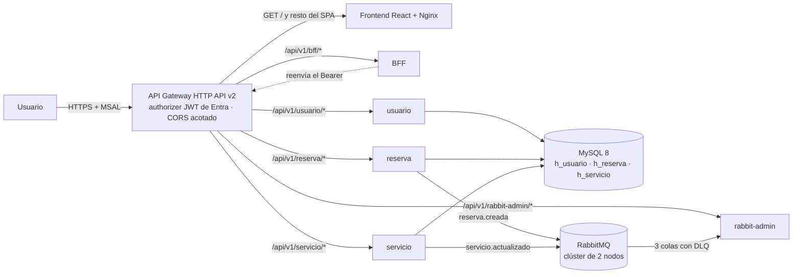

# CloudNative01 — Sistema Hotelero (DSY1107 / EP1 + EP2)

Plataforma de gestión hotelera tipo microservicios: 3 microservicios de dominio, un BFF y el microservicio de mensajería `rabbit-admin`, todos en Spring Boot 4, que validan tokens JWT emitidos por Microsoft Entra ID, una base de datos MySQL y un frontend React 19 (lenguaje autorizado por el docente en reemplazo de Angular) que se autentica contra Entra ID con la librería MSAL.

> **Estado actual:** núcleo completo y verificado (148 tests, mensajería con evidencia en vivo y frontend público vía el API Gateway). Placeholder heredado de EP1: `/registro`.

**Cómo cumple la rúbrica EP1:**
- **Indicador 1 — MSAL (60%):** login/logout por redirección de Entra ID, guard de rutas por autenticación y rol (`RequireAuth`), inyección del `Bearer` token en cada petición HTTP, roles/scopes leídos desde los claims del JWT, vistas funcionales.
- **Indicador 2 — BFF (40%):** microservicio `bff` (Spring Boot 4.1.1, `:8084`) que valida el JWT de Entra ID (`issuer-uri`, `audience`, firma JWKS y vigencia), exige autenticación en todas sus rutas, aplica autorización por rol con `@PreAuthorize` y responde `401 AUTH-001` o `403 AUTH-003`. Agrega usuario + reservas + el catálogo de servicios (`GET /api/v1/bff/dashboard`) reenviando el `Bearer` al API Gateway. La vista "Mi cuenta" del frontend lo consume.

**Cómo cumple la rúbrica EP2 (mensajería):**
- **Centralización (12%) + Beans (13%):** topología completa en `rabbit-admin/src/main/resources/application.yml` (`hotel.mensajeria.*`) y beans `Queue`/`Exchange`/`Binding` en `RabbitMqConfig` (3 colas + 3 DLQ, exchange topic para eventos, direct para tareas puntuales y DLX). Cero nombres sueltos en el código.
- **Separación (10%) + Servicio dedicado (10%):** microservicio `rabbit-admin` (`:8085`) con `RabbitAdminService` como única puerta a AMQP. Los controladores no conocen detalles de RabbitMQ y los procesadores de dominio no conocen la mensajería.
- **Consumidores por dominio (15%):** `@RabbitListener` agrupados en `listener/notificacion`, `listener/ticket` y `listener/documento` (cada uno con su procesador).
- **ACK y errores (20%):** política de 3 rutas — éxito → `basicAck`, evento inválido → `NACK` sin reencolar (DLQ directa), fallo recuperable → `NACK` reencolando **una vez**, y si la reentrega falla, `NACK` sin reencolar (DLQ). Todo registrado en logs.
- **Admin REST (13%) + Validación (7%):** endpoints REST con DTOs `@Valid` y códigos `VALID-001/002` y `MSJ-*`.
- **Productores:** `reserva` publica `reserva.creada` (→ notificaciones + tickets) y `servicio` publica `servicio.actualizado` (→ documentos), ambos **fail-safe** (si RabbitMQ cae, la operación de negocio no se pierde) y con **publisher confirms + returns** (modo `correlated`): cada publicación queda confirmada por el broker y un mensaje sin cola destino se devuelve y se registra (`PublicacionObservable`).
- **Presentación (18%):** clúster RabbitMQ de **2 nodos** con docker-compose en `cn-rabbit`, dashboard por túnel SSH, y todo re-demostrable a través del API Gateway.

## Arquitectura

### 1. Visión general

CloudNative01 es una plataforma de gestión hotelera: frontend React 19 con login MSAL contra Entra ID, un API Gateway que valida el JWT y enruta, un BFF que agrega los dominios para las vistas, 3 microservicios de negocio (`usuario`, `reserva` y `servicio`) y `rabbit-admin`, el microservicio dedicado a la mensajería. `reserva` y `servicio` publican sus eventos a un clúster RabbitMQ de 2 nodos, y `rabbit-admin` los consume con ACK manual y DLQ.



Cada microservicio es dueño de su base (`h_usuario`, `h_reserva`, `h_servicio`) dentro de una única instancia MySQL 8.

### 2. Capas

| Capa | Tecnología | Puerto |
|------|-----------|--------|
| Frontend | React 19 + Vite 8 + MSAL (Microsoft Entra ID) | `5173` dev · `80` EC2 · gateway https (público) |
| Microservicio usuario | Spring Boot 4.1.1 + OAuth2 Resource Server | `8083` |
| Microservicio reserva | Spring Boot 4.1.1 + OAuth2 Resource Server | `8081` |
| Microservicio servicio | Spring Boot 4.1.1 + OAuth2 Resource Server | `8082` |
| BFF | Spring Boot 4.1.1 + OAuth2 Resource Server | `8084` |
| rabbit-admin | Spring Boot 4.1.1 + OAuth2 Resource Server + Spring AMQP | `8085` |
| RabbitMQ | Clúster de 2 nodos (docker-compose, `rabbitmq:4.2-management`) | `5672` (AMQP) |
| Base de datos | MySQL 8 (Docker en local · nativo en la EC2 de usuario) | `3306` |

Cada microservicio lee su configuración por variables de entorno (todas con default en `application.properties`) y valida JWT con el issuer de Entra ID del tenant `tenaninternoemihormazabal.onmicrosoft.com` y la audience del client ID de la app.

**Presentación.** `Frontend/` es la aplicación React 19 + Vite 8: login por redirección con MSAL, guard de rutas por autenticación y rol (`RequireAuth`), `apiClient` que inyecta el `Bearer` en cada petición, y las vistas de servicios, cuenta y panel de administración. Se sirve por nginx en su EC2 y, como vía pública, por el mismo API Gateway — MSAL exige contexto seguro, así que la URL oficial del frontend es la del gateway (https).

**Entrada y orquestación.** El API Gateway HTTP API v2 valida el token con el authorizer JWT de Entra (firma, `iss`, `aud`), acota CORS a los orígenes propios y enruta `/api/v1/{micro}/{proxy+}` a cada microservicio, además de servir el SPA en `GET /` y `GET /{proxy+}` sin JWT. El **BFF** es el punto de entrada de las vistas que agregan dominios: compone usuario + reservas + catálogo en `GET /api/v1/bff/dashboard` y el resumen global en `GET /api/v1/bff/admin/resumen` (ADMIN), reenviando el `Bearer` al gateway.

**Dominio distribuido.** Cada microservicio es dueño de un contexto:

- `usuario`: identidad local (la fila nace en el primer `/me`), roles y CRUD de usuarios.
- `reserva`: reservas y publicación de `reserva.creada` al confirmar el alta.
- `servicio`: catálogo de servicios del hotel y publicación de `servicio.actualizado`.
- `rabbit-admin`: administración REST del broker y los 3 consumidores por dominio (notificaciones, tickets y documentos).

**Mensajería.** Clúster RabbitMQ de 2 nodos en `cn-rabbit` (docker-compose), con la topología declarada una sola vez por `rabbit-admin` al arrancar. El detalle está en [Mensajería (EP2)](#mensajería-ep2).

**Persistencia.** MySQL 8 con una base por microservicio (`h_usuario`, `h_reserva`, `h_servicio`): en la nube vive en la EC2 de `usuario` y solo acepta conexiones entre las EC2 del grupo, y en local es el contenedor `hotel-mysql`. Las tablas las crea Hibernate (`ddl-auto=update`) y los seeds se aplican a mano tras el primer arranque (ver [Puesta en marcha](#puesta-en-marcha-paso-a-paso)).

### 3. Flujo de una solicitud

1. El usuario abre el SPA (por el gateway) e inicia sesión con MSAL contra Entra ID.
2. El navegador llama al API Gateway con `Authorization: Bearer` — el SPA y la API comparten origen.
3. El gateway valida el token (authorizer JWT) y enruta `/api/v1/{micro}/…` al microservicio correspondiente.
4. El microservicio revalida el token (resource server), aplica el rol con `@PreAuthorize` y ejecuta la regla de negocio.
5. Persiste en su base y, si el flujo lo amerita, publica el evento al broker con confirmación (fail-safe: la operación no se pierde si RabbitMQ cae).
6. La respuesta vuelve normalizada al navegador. Si la vista agrega varios dominios (Mi cuenta), el BFF es quien compone la respuesta.

### 4. Seguridad

- **OAuth2/JWT con Entra ID** como proveedor de identidad: MSAL en el frontend y OAuth2 Resource Server en los 5 microservicios.
- **Doble validación:** el gateway valida firma, `iss` y `aud` en el borde, y cada microservicio revalida el token (defensa en profundidad).
- **Autorización por rol:** el claim `roles` del JWT se aplica con `@PreAuthorize` (escrituras solo `ADMIN`), con errores normalizados `401 AUTH-001` y `403 AUTH-003`.
- **CORS acotado:** nunca abierto, orígenes por variable `CORS_ORIGINS` (localhost + Elastic IP del frontend) y métodos y cabeceras explícitos, tanto en el gateway como en los 5 microservicios.
- **Superficie mínima:** el navegador solo conoce el API Gateway, y no hay secretos en el repositorio (las contraseñas de MySQL y Rabbit las genera Terraform y los `.env` reales no se versionan).

### 5. Estado actual

| Componente | Estado |
| --- | --- |
| Frontend (MSAL) | Login/logout, guard por rol, `Bearer` automático y vistas de servicios, cuenta y panel admin operativas |
| BFF | Dashboard agregado y resumen admin sobre el gateway |
| Microservicios | CRUD completo con validación de entrada, roles y errores normalizados |
| Mensajería | Clúster de 2 nodos, topología centralizada, productores fail-safe y 3 consumidores con ACK manual + DLQ |
| Infraestructura | VPC propia, 7 EC2, API Gateway con JWT, Elastic IP y CORS acotado (Terraform) |
| Pruebas | 148 tests (JUnit, MockMvc, H2 y broker real) con cobertura JaCoCo |

**Pendiente declarado:** el alta de usuarios (`/registro`) es un placeholder de EP1 (sin enlace en la navegación). El microservicio `reserva` ya expone todos sus endpoints y `/mis_reservas` lista las reservas del usuario a través del BFF.

## Estructura del repositorio

```
├── Frontend/            # React 19 + Vite + MSAL
│   └── src/
│       ├── auth/        # MSAL (authConfig, msalInstance, authUtils), interceptor HTTP y RequireAuth
│       ├── components/  # Tarjeta_servicios, Formulario_servicios, Modificar_servicios
│       ├── pages/       # Inicio, Login, Registrarse, Mi_cuenta, Servicios (lista y detalle), Reservas (lista y detalle), Panel_admin, etc.
│       ├── routes/      # RouterConfig (rutas protegidas por RequireAuth)
│       ├── services/    # servicioService y bffService (consumo vía apiClient)
│       └── utils/       # environment.ts (tenant, clientId, redirectUri y base URL del API Gateway)
├── usuario/             # Microservicio: usuarios  (Spring Boot 4, :8083)
├── reserva/             # Microservicio: reservas  (Spring Boot 4, :8081)
├── servicio/            # Microservicio: servicios (Spring Boot 4, :8082)
├── bff/                 # BFF: dashboard del frontend (Spring Boot 4, :8084)
├── rabbit-admin/        # Administración de RabbitMQ + consumidores por dominio (Spring Boot 4, :8085)
├── db-init/             # init.sql — crea h_usuario, h_reserva y h_servicio (solo DDL de infraestructura)
├── seeds/               # seed_usuarios.sql + seed_servicios.sql (idempotentes, se aplican a mano)
├── infra/               # Terraform (AWS): VPC propia + 7 EC2 t2.micro + SG + API Gateway con JWT
│   └── rabbit-cluster/  # docker-compose del clúster RabbitMQ de 2 nodos + script de unión al clúster
├── docker-compose.yml   # MySQL 8 con datos persistidos en volumen
└── .env.example         # Plantilla de variables de entorno (DB, puertos, tenant de Entra)
```

## Requisitos previos

- **Docker Desktop** (para MySQL) o un MySQL 8.0 local en `localhost:3306`
- **Java 21** — los microservicios compilan a bytecode 21 (tests con `mvnw.cmd` en usuario/reserva/servicio y `mvn` global en bff/rabbit-admin, con JAVA_HOME apuntando a JDK 21+)
- **Node.js 20.19+ o 22.12+** (requisito real de Vite 8. Node 18 no compila este proyecto)
- Una cuenta de usuario en el tenant de Entra ID `tenaninternoemihormazabal.onmicrosoft.com`

## Puesta en marcha (paso a paso)

### 1. Base de datos

```bash
docker compose up -d
```

Levanta el contenedor `hotel-mysql` (usuario `root`, contraseña `root`) y, en la primera inicialización, ejecuta `db-init/init.sql` (crea `h_usuario`, `h_reserva` y `h_servicio`).

Las **tablas** no las crea MySQL: las crea Hibernate (`ddl-auto=update`) al arrancar cada microservicio. Por eso el **seed se aplica manualmente y siempre después del primer arranque** de los microservicios. Es idempotente:

```bash
docker exec -i hotel-mysql mysql -uroot -proot < seeds/seed_usuarios.sql
docker exec -i hotel-mysql mysql -uroot -proot < seeds/seed_servicios.sql
```

**En PowerShell (Windows)** la redirección `<` no existe, usa `cmd`:

```powershell
cmd /c "docker exec -i hotel-mysql mysql -uroot -proot < seeds\seed_usuarios.sql"
cmd /c "docker exec -i hotel-mysql mysql -uroot -proot < seeds\seed_servicios.sql"
```

### 2. Microservicios

Compilar y levantar cada microservicio en su terminal (usa el wrapper inclusivo, no el `mvn` global):

```bash
cd usuario && .\mvnw.cmd package -DskipTests
java -jar target\usuario-0.0.1-SNAPSHOT.jar
```

```bash
cd reserva && .\mvnw.cmd package -DskipTests
java -jar target\reserva-0.0.1-SNAPSHOT.jar
```

```bash
cd servicio && .\mvnw.cmd package -DskipTests
java -jar target\servicio-0.0.1-SNAPSHOT.jar
```

```bash
cd bff && mvn package -DskipTests
java -jar target\bff-0.0.1-SNAPSHOT.jar
```

> El módulo `bff` no trae wrapper de Maven, se compila con el `mvn` global (3.9.14).

> `rabbit-admin` tampoco trae wrapper: `cd rabbit-admin && mvn package -DskipTests` y `java -jar target\rabbit-admin-0.0.1-SNAPSHOT.jar`, apuntando al broker con las variables `RABBITMQ_*` (ver `.env.example`).

Variables de entorno que leen los microservicios (todas con default):

| Variable | Default | Uso |
|----------|---------|-----|
| `DB_HOST` / `DB_PORT` | `localhost` / `3306` | Servidor MySQL |
| `DB_NAME` | `h_usuario` / `h_reserva` / `h_servicio` | Base de cada microservicio |
| `DB_USERNAME` / `DB_PASSWORD` | `root` / *(vacío)* | Credenciales MySQL |
| `SERVER_PORT` | `8083` / `8081` / `8082` / `8084` / `8085` | Puerto del API (8085 = rabbit-admin) |
| `AZURE_TENANT_ID` | `e34a6311-…5455a0` | Emisor del JWT (issuer) |
| `AZURE_AUDIENCE` | `46cda96c-…1226` | Audience del JWT (client ID) |

**Importante:** si se levanta el jar sin `DB_PASSWORD` y MySQL exige contraseña, el arranque falla con `Access denied using password: NO`. En Windows:

```powershell
$env:DB_PASSWORD = "root"
java -jar target\usuario-0.0.1-SNAPSHOT.jar
```

**Java del PATH:** los jars requieren Java 21+. Si `java -version` muestra una versión menor, ejecutar con el JDK 21 explícito (p. ej. `& "C:\Users\<usuario>\.jdks\ms-21.0.11\bin\java.exe" -jar target\...`) o dejar ese JDK primero en el PATH (de lo contrario el arranque falla con `UnsupportedClassVersionError`).

**Seeds (después del primer arranque de los 3 microservicios):** usuarios demo + 4 servicios de ejemplo.

```bash
docker exec -i hotel-mysql mysql -uroot -proot < seeds/seed_usuarios.sql
docker exec -i hotel-mysql mysql -uroot -proot < seeds/seed_servicios.sql
```

### 3. Frontend

```bash
cd Frontend
npm install
npm run dev
```

Abrir [http://localhost:5173](http://localhost:5173) — el `redirectUri` de MSAL es el origen actual (`window.location.origin`, registrado en Entra para localhost y para la URL pública del gateway, ver más abajo). El client ID/tenant viven en `Frontend/src/utils/environment.ts` y la base URL del API se puede sobreescribir por `VITE_API_BASE_URL` (ver `Frontend/.env.example`).

> **Modo actual (demo):** `environment.ts` apunta al API Gateway de AWS (un solo origen), así el frontend local consume la nube. Para apuntar a otro gateway se define `VITE_API_BASE_URL` (ver `Frontend/.env.example`) o se edita el valor por defecto. El BFF, en local, sigue aceptando `MICROSERVICIOS_*_URL` para resolver sus 3 destinos.

> **Frontend en la nube:** el `dist` se sirve directo desde la EC2 por HTTP (puerto 80) y — la vía pública — a través del **mismo API Gateway**: `https://z8bmmvfdwh.execute-api.us-east-1.amazonaws.com/` (rutas `GET /` y `GET /{proxy+}` sin JWT). Por HTTP directo la app no inicializa (MSAL v5 exige contexto seguro, `crypto.subtle`), así que la URL oficial del frontend es la del gateway: certificado real, login MSAL operativo desde cualquier navegador y llamadas al API en el mismo origen. Su redirect URI está registrado en Entra junto al de localhost.

Accesos locales una vez levantado el stack:

| Recurso | Dónde |
|---------|-------|
| Frontend dev | `http://localhost:5173` |
| Frontend público | `https://z8bmmvfdwh.execute-api.us-east-1.amazonaws.com/` |
| usuario · reserva · servicio · bff · rabbit-admin | `:8083` · `:8081` · `:8082` · `:8084` · `:8085` |
| MySQL local (Docker) | `localhost:3306` (`hotel-mysql`, root/root) |
| Broker de tests | `localhost:5680` (`cn-rabbit-audit`, hotel/hotel123) |
| Swagger rabbit-admin | `http://localhost:8085/swagger-ui/index.html` |

## Manual de usuario

### Iniciar sesión

1. En la barra superior hacer clic en **Iniciar sesión**.
2. MSAL redirige a la página de Microsoft Entra ID.
3. Entrar con una cuenta del tenant. **Credenciales de prueba:**

| Cuenta | Rol | Acceso |
|--------|-----|--------|
| `admin.prueba@tenaninternoemihormazabal.onmicrosoft.com` | Admin | Panel de administración y CRUD de servicios |
| `cliente.prueba@tenaninternoemihormazabal.onmicrosoft.com` | Cliente | Solo lectura de servicios y de sus reservas |

### Navegación y roles

| Ruta | Vista | Requiere |
|------|-------|----------|
| `/` | Inicio | Público |
| `/registro` | Registro | **Pendiente** — vista placeholder vacía, sin enlace en la navegación |
| `/login` | Iniciar / cerrar sesión | Público |
| `/servicios` | Listado de servicios (desde BD) | Autenticado |
| `/servicios/detalle` | Detalle de un servicio | Autenticado |
| `/mi_cuenta` | Datos del JWT + resumen agregado por el BFF (usuario, reservas y catálogo de servicios) | Autenticado |
| `/mis_reservas` | Reservas del usuario | Autenticado |
| `/mis_reservas/detalle` | Detalle de reserva | Autenticado |
| `/PanelAdministradores` | Panel admin (alta/baja/edición de servicios) | Rol `Admin` |

- Usuario autenticado que accede a `PanelAdministradores` sin rol `Admin` ve **"Acceso denegado"**.
- Usuario no autenticado es redirigido a `/login` desde cualquier ruta protegida.
- Los roles se leen del claim `roles` del JWT (no de la base de datos).
- **Pendiente de implementar:** el alta de usuarios (`/registro`) — placeholder vacío (el alta la gestiona Entra ID), que quedó sin enlace en la navegación. Su eliminación definitiva queda para la próxima entrega, porque la gestión de usuarios corresponde a Entra ID. El microservicio **reserva ya expone todos sus endpoints** (ver sección API) y `/mis_reservas` lista las reservas del usuario a través del BFF.

### Flujo de uso (inicio a fin)

1. Abrir `http://localhost:5173`. Vista Inicio.
2. **Iniciar sesión** con una cuenta demo (Admin o Cliente).
3. En `/mi_cuenta` se muestran el correo, el rol y los scopes del token, más el resumen agregado por el BFF (usuario, reservas y catálogo de servicios).
4. Consultar `/servicios` para ver los 4 servicios sembrados (carga vía API Gateway desde el microservicio en AWS, con Bearer).
5. **Como Admin:** entrar a `/PanelAdministradores` y probar crear / editar / eliminar servicios.
6. Cerrar sesión con el botón correspondiente.

> El flujo **Cliente → reservar → `/mis_reservas`**: la vista ya lista las reservas del usuario (vía BFF). El alta de reservas sigue siendo de administración (`POST /reserva` es ADMIN).

## API (endpoints)

**Todos** los endpoints requieren un JWT de Entra ID válido (`Authorization: Bearer <token>`). Sin token responden `401` y con rol insuficiente `403`. Los roles se aplican con `@PreAuthorize` (escrituras reservadas a `ADMIN`).

> Los POST y PUT de `reserva`, `servicio` y `rabbit-admin` validan la entrada: campos inválidos responden `400 VALID-001` con el detalle por campo, y un JSON malformado `400 VALID-002`.

> El alta de usuarios la gestiona Entra ID (MSAL). La fila local se crea en el primer acceso al endpoint `/me` y el campo `contrasenia` de la base de datos queda sin uso (los endpoints legacy `register` y `login` fueron eliminados para no exponer superficie anónima).

### Microservicio usuario — `http://localhost:8083/api/v1/usuario`

| Método | Ruta | Descripción | Rol |
|--------|------|-------------|-----|
| GET | `/me` | Usuario autenticado resuelto por el claim del token (se crea en su primer acceso) | autenticado |
| GET | `/get/{id}` | Usuario por id | ADMIN |
| GET | `/list` | Listar usuarios | ADMIN |
| PUT | `/put/{id}` | Actualizar usuario | ADMIN |
| DELETE | `/delete/{id}` | Eliminar usuario | ADMIN |

### Microservicio reserva — `http://localhost:8081/api/v1/reserva`

| Método | Ruta | Descripción | Rol |
|--------|------|-------------|-----|
| POST | `/post` | Crear reserva | ADMIN |
| GET | `/get/{id}` | Reserva por id | autenticado |
| GET | `/list` | Listar reservas | autenticado |
| GET | `/usuario/{idUsuario}` | Reservas de un usuario | autenticado |
| PUT | `/put/{id}` | Actualizar reserva | ADMIN |
| DELETE | `/delete/{id}` | Eliminar reserva | ADMIN |

### Microservicio servicio — `http://localhost:8082/api/v1/servicio`

| Método | Ruta | Descripción | Rol |
|--------|------|-------------|-----|
| POST | `/post` | Crear servicio | ADMIN |
| GET | `/get/{id}` | Servicio por id | autenticado |
| GET | `/list` | Listar servicios | autenticado |
| PUT | `/put/{id}` | Actualizar servicio | ADMIN |
| DELETE | `/delete/{id}` | Eliminar servicio | ADMIN |

### BFF — `http://localhost:8084/api/v1/bff`

| Método | Ruta | Descripción | Rol |
|--------|------|-------------|-----|
| GET | `/dashboard` | Agrega usuario + reservas + el catálogo de servicios | autenticado |
| GET | `/admin/resumen` | Resumen global: usuarios + reservas + servicios | ADMIN |

## Mensajería (EP2)

Topología declarada **únicamente** por `rabbit-admin` al arrancar (idempotente):

| Cola | DLQ | Binding | Evento |
|------|-----|---------|--------|
| `notificaciones.queue` | `notificaciones.dlq` | `hotel.topic` ← `reserva.*` | `reserva.creada` |
| `tickets.queue` | `tickets.dlq` | `hotel.topic` ← `reserva.creada` y `hotel.direct` ← `ticket.generar` | `reserva.creada` |
| `documentos.queue` | `documentos.dlq` | `hotel.topic` ← `servicio.*` | `servicio.actualizado` |

- Todos los exchanges y colas son `durable`. Las colas derivan a su DLQ por `hotel.dlx` y cada DLQ retiene sus mensajes 24 h (`x-message-ttl`) como política de retención.
- Los eventos viajan como JSON (`JacksonJsonMessageConverter`, idéntico en productores y consumidores).
- **ACK manual (3 rutas):** éxito → `basicAck` · inválido → `basicNack(false)` (DLQ directa) · recuperable → `basicNack(true)` (un reintento) y en la reentrega → `basicNack(false)` (DLQ).

### API del administrador — `http://localhost:8085/api/v1/rabbit-admin`

| Método | Ruta | Descripción | Rol |
|--------|------|-------------|-----|
| POST | `/queues` | Crear cola durable | ADMIN |
| GET | `/queues/{nombre}` | Info de una cola (mensajes, consumidores) | autenticado |
| DELETE | `/queues/{nombre}` | Eliminar cola | ADMIN |
| POST | `/queues/{nombre}/purge` | Vaciar cola | ADMIN |
| POST | `/exchanges` | Crear exchange (direct/topic) | ADMIN |
| DELETE | `/exchanges/{nombre}` | Eliminar exchange (idempotente en el broker) | ADMIN |
| POST | `/bindings` | Crear binding cola↔exchange | ADMIN |
| POST | `/publish` | Publicar un mensaje de prueba (JSON) en un exchange | ADMIN |

> `rabbit-admin` expone además Swagger UI en `/swagger-ui/index.html` (junto con `/v3/api-docs`, sin token. La API de administración sigue exigiendo JWT).

### Mensajería en local

Los tests de integración usan el contenedor `cn-rabbit-audit` (`5680`/`15680`, usuario `hotel`/`hotel123`):

```bash
docker run -d --name cn-rabbit-audit -p 5680:5672 -p 15680:15672 -e RABBITMQ_DEFAULT_USER=hotel -e RABBITMQ_DEFAULT_PASS=hotel123 rabbitmq:4.2-management
```

Sin ese contenedor, las suites de integración se omiten solas (los unitarios corren igual).

## Pruebas

```bash
.\mvnw.cmd test     # en usuario / reserva / servicio (wrapper)
mvn test            # en bff y rabbit-admin (usan Maven global)
npm run lint        # en Frontend (oxlint)
npm run build       # en Frontend (build de producción)
```

El proyecto suma **148 tests** (usuario 28, reserva 29, servicio 30, bff 14, rabbit-admin 47): arranque de contexto, mapeo de claims JWT→roles, control de acceso con cuerpos `AUTH-001`/`AUTH-003`, rutas inexistentes y métodos no permitidos (`404 SYS-002` / `405 SYS-003`), resolución por token del endpoint `/me` (con creación del usuario en su primer acceso), alta concurrente tolerante a conflicto, validación de entrada de los dominios (`400 VALID-001` por campo, `400 VALID-002` para JSON ilegible o parámetro de ruta con formato inválido, y `415 VALID-002` para content-type no soportado) y dashboard/resumen por token en el BFF. Los servicios de `usuario`, `reserva` y `servicio` tienen cobertura de integración real (H2 + broker): CRUD completo, rutas de no-encontrado y evento de alta verificado en la cola de auditoría. La cobertura se mide con **JaCoCo** en los 5 módulos (reporte HTML en `target/site/jacoco/`): **74,6% de líneas y 75,9% de ramas** en el global (usuario 60,3 · reserva 71,2 · servicio 75,7 · bff 78,6 · rabbit-admin 84,3). En `rabbit-admin`: topología y CRUD contra un **broker real**, contrato de confirmación de los 3 consumidores (ACK/NACK/DLQ), **flujo real de reintentos** (fallo transitorio → confirma al segundo intento, fallo persistente → un reintento → DLQ), prueba de volumen ligera (200 eventos), publicación de prueba (`POST /publish`) contra broker real y exposición de Swagger. Los productores de `reserva` y `servicio` tienen unitarios (exchange, routing key, payload, fail-safe y observador de confirms/returns) e integración contra broker con cola de auditoría (incluye publicación confirmada y devolución de un mensaje sin cola destino). La batería de rendimiento (escalera de VUs sobre `GET /servicio/list` y `POST /reserva/post`, sondas por capa y ventana de recuperación) se ejecutó contra el API Gateway. El informe de rendimiento y los resultados crudos acompañan las evidencias de la entrega.

### Análisis estático (SonarQube)

Los **148 tests automatizados** (JUnit 5 + MockMvc + integración con H2 y broker) fueron revisados con **SonarQube** (scanner del IDE IntelliJ IDEA), fuente fidedigna de análisis estático, junto con el código de los 5 módulos Java, el frontend y el IaC de Terraform. Los avisos remanentes son **convenciones deliberadas del proyecto, no defectos**: los campos `snake_case` de las entidades (`s_nombre`, `a_paterno`, `dv_rut`, …) mapean las columnas MySQL ya definidas, los prefijos de capa de controladores y servicios (`uc_`/`u_`, `rc_`/`r_`, `sc_`/`s_`, `rac_`/`ra_`, `bc_`/`b_`, presentes también en locales como `u_mod`, `r_mod` y `s_mod`) marcan su módulo, los nombres de los componentes JSX son espejo de sus clases, y las sugerencias de sintaxis Java 22+ quedan descartadas al fijar `sonar.java.source=21`. El scan final deja **70 avisos** (exclusivamente esas convenciones) con **0 Security Hotspots** y el análisis de secretos completado. El único hallazgo real (índice del array como `key` en las listas de React) fue corregido. En EP2 se corrigieron además constantes duplicadas, expresiones regulares con backtracking, paréntesis innecesarios y zonas horarias explícitas en **todos** los módulos. En el IaC, la IP pública de las EC2 es deliberada —el API Gateway integra por IP y el laboratorio exige SSH— y quedó explícita en `main.tf`.

## Infraestructura (AWS)

`infra/main.tf` despliega en `us-east-1`, en VPC propia (`10.0.0.0/16` + subred pública):

```
Navegador (MSAL → Entra ID)
   │  https + Bearer JWT
   ▼
API Gateway HTTP API v2  ·  JWT authorizer Entra  ·  CORS acotado  ·  logs 30 días
   │  sirve el SPA en /  ·  enruta /api/v1/{micro}/… a cada microservicio
   ▼
VPC 10.0.0.0/16 (subred pública, 7 EC2 t2.micro AL2023)
   ├─ cn-frontend       nginx + dist React  ·  Elastic IP 34.237.20.142
   ├─ cn-usuario        :8083  microservicio + MySQL 8 (h_usuario, h_reserva, h_servicio)
   ├─ cn-reserva        :8081  publica reserva.creada
   ├─ cn-servicio       :8082  publica servicio.actualizado
   ├─ cn-bff            :8084  agrega datos y consume la API vía gateway
   ├─ cn-rabbit         clúster RabbitMQ de 2 nodos (docker compose)
   └─ cn-rabbit-admin   :8085  admin REST + 3 consumidores (ACK manual)
Security Group: 80 y 8081-8085 abiertos  ·  22 con llave  ·  3306 y 5672 solo entre EC2 del grupo
```

- **7 EC2 `t2.micro`** (AL2023): frontend (nginx), `usuario` (microservicio + MySQL 8 con `h_usuario`, `h_reserva`, `h_servicio`), `reserva`, `servicio` y `bff` (microservicio + JDK 21), más las dos de EP2: `cn-rabbit` (clúster RabbitMQ de 2 nodos con docker-compose) y `cn-rabbit-admin` (microservicio `rabbit-admin`, `:8085`). Las 7 usan el mismo par `cloudnative-labs`, gestionado por Terraform desde `infra/keys/cloudnative-labs.pub` (la privada no está en el repo). Cada microservicio tiene su servicio `systemd` (`cn-*`).
- **Security Group**: 8081–8085 y 80 públicos (API Gateway + verificación), SSH 22 (lab), 3306 y **5672 solo entre EC2 del grupo**. El dashboard de RabbitMQ (`15672`) **no se abre a Internet**: se accede por túnel SSH.
- **API Gateway HTTP API v2** con authorizer **JWT Entra** (valida, no solo pasa el token), CORS y rutas `OPTIONS` sin auth para que el preflight no caiga en el authorizer. Proxy `/{proxy+}` hacia cada microservicio, incluido `rabbit-admin`, y logs de acceso en CloudWatch (retención 30 días). También sirve el frontend público en `GET /` y `GET /{proxy+}` sin JWT, solo archivos estáticos. Las rutas `/api/v1/*` mantienen su authorizer JWT.

```bash
cd infra
terraform init
terraform plan
terraform apply   # responde yes
```

Las credenciales del broker las genera Terraform (`random_password`, igual que la de MySQL): no viven en el repositorio y se recuperan con `terraform output -raw rabbit_pass` (quedan en el `tfstate` local, que no se commitea).

Despliegue post-apply:

1. Subir los 5 jars (`usuario`, `reserva`, `servicio`, `bff`, `rabbit-admin`) a `/opt/apps/` y `systemctl start cn-*`.
2. **Clúster RabbitMQ:** copiar `infra/rabbit-cluster/` a la EC2 `cn-rabbit`, crear `.env` (cookie, usuario y la contraseña de `terraform output -raw rabbit_pass`) y ejecutar `docker compose --env-file .env up -d` y luego `bash unirse-cluster.sh`.
3. Seeds de MySQL (`seeds/seed_usuarios.sql`, `seeds/seed_servicios.sql`) y `dist/` del frontend a `/var/www/grandhotel` + `sudo chmod -R a+rX /var/www/grandhotel`.
4. **Orden de arranque en la nube:** broker → `rabbit-admin` (declara la topología) → `reserva`/`servicio` (productores) → resto de microservicios.

> **CORS de los microservicios:** cada servicio limita sus orígenes con la variable `CORS_ORIGINS` (default `http://localhost:5173`, nunca queda abierto) y sus métodos y cabeceras permitidas son explícitos (`authorization`, `content-type`). Terraform la declara en el `user_data` de cada EC2 (los orígenes locales + la Elastic IP del frontend). En las instancias del lab está aplicada como drop-in de systemd (`/etc/systemd/system/cn-<svc>.service.d/10-cors.conf`) y se re-aplica sola si las EC2 se recrean.

Outputs: `frontend_public_ip`, `usuario_public_ip`, `usuario_private_ip`, `microservicios_public_ip`, `rabbit_public_ip`, `rabbit_admin_public_ip`, `api_url`, `rabbit_private_ip`, `db_password` y `rabbit_pass` (sensitive).

> **Las IPs se leen de Terraform, nunca se copian a mano** (las dinámicas cambian cada vez que el lab reinicia las EC2, la del frontend es fija vía Elastic IP): `terraform -chdir=infra output` muestra todo, `terraform output -raw frontend_public_ip` da la del frontend y `terraform output -json microservicios_public_ip` las de reserva/servicio/bff. Un `apply` refresca solo las integrations del gateway y el CORS — no hay que editar archivos.

> **Despliegue limpio (gateway nuevo):** las EC2 `reserva`, `servicio` y `bff` reciben las 3 variables `MICROSERVICIOS_*_URL` con el `api_endpoint` generado por Terraform (user_data). Para el frontend, el build toma el gateway desde `environment.ts` o `VITE_API_BASE_URL` (ver `Frontend/.env.example`) — recompilar `dist/` si cambia. Tras subir el `dist/`, ejecutar `sudo chmod -R a+rX /var/www/grandhotel` para que nginx pueda leer los assets (el scp los deja con permisos restrictivos).

> Si las EC2 se reinician cambian sus IPs públicas (salvo el frontend, que conserva su Elastic IP): correr `terraform apply` de nuevo para refrescar las integrations. En AWS Academy el lab se corta a las 4 horas y detiene las EC2, así que al volver hay que arrancarlas de nuevo — el auto-arranque de la plataforma puede fallar, verificar SIEMPRE que las 7 estén `running` antes de aplicar. **Con las EC2 detenidas el plan muestra un destroy falso (artefacto) que NO se debe aplicar** (recrearía las instancias y se perdería el despliegue). Tras la demo: `terraform destroy`.

**Dashboard de RabbitMQ sin exponerlo a Internet** (túnel SSH desde local):

```bash
ssh -i <llave-correspondiente>.pem -L 15672:localhost:15672 ec2-user@<IP_PUBLICA_DE_cn-rabbit>
```

Todas las EC2 usan el par `cloudnative-labs` (privada fuera del repositorio. La pública vive en `infra/keys/`).

Luego abrir `http://localhost:15672` en el navegador (usuario `hotel` y la contraseña del apply).

> **Drill obligatorio el día de la presentación:** Start Lab → `aws configure` → arrancar las 7 EC2 (verificar `running`) → `terraform apply` (las IPs cambian y el gateway debe refrescar sus integrations) → **smoke CON token** (login + dashboard + servicios cargando — el 401 solo prueba el authorizer, no las integrations) → recién presentar.

> **Costos (AWS Academy):** gasto real ≈ $7,3 de $50 al 11-oct (panel Vocareum). Encendido ≈ $0,12/hora (7 EC2 + IPs). El frontend usa una **Elastic IP** (≈$0,12/día, también en reposo) para que su URL y su CORS queden estables entre sesiones del lab. El resto de EC2 mantiene IP dinámica. `terraform destroy` al cierre libera todo, incluida la EIP. El diseño prioriza el costo marginal por sesión en lugar de un stack 24/7.

## Credenciales y seguridad

- Las claves públicas de Entra ID (clientId, tenant) quedan definidas en `Frontend/src/utils/environment.ts`, y el issuer/audience (`AZURE_TENANT_ID`/`AZURE_AUDIENCE`) en la configuración de cada microservicio. No hay secretos comprometidos en el repositorio. La contraseña de MySQL (`root`) y los identificadores de Entra son solo para el entorno local de desarrollo.
- `.env.example` es plantilla de los microservicios (DB, puertos, tenant, audience) y `Frontend/.env.example` la del frontend (`VITE_API_BASE_URL`). Los `.env` reales **no se suben** a Git.
- El `.gitignore` raíz excluye `.env`, `node_modules`, `target/`, `*.log` y artefactos de compilación. `infra/.gitignore` excluye `.terraform/`, `.tfstate` y `.tfvars`.

## Mejoras evaluadas

Opciones de evolución analizadas contra el alcance del entregable. La evaluación es deliberada (costo, beneficio y contexto) y no implica implementación:

| Mejora | Qué aportaría | Costo estimado | Decisión |
|--------|---------------|----------------|----------|
| Outbox transaccional en los productores | Entrega garantizada (at-least-once) de los eventos, incluso con el broker caído | Alto: tabla outbox, dispatcher con backoff y pruebas nuevas | Diferida — el fail-safe + confirms/returns cubren el requisito de la EV2 |
| Versionado de eventos (`v1`) + `X-Correlation-Id` | Contratos evolutivos y trazabilidad entre servicios | Medio: productores, consumidores y pruebas | Diferida |
| Endpoints múltiples del broker (`SPRING_RABBITMQ_ADDRESSES`) | Los clientes podrían alcanzar ambos nodos del clúster | Bajo en código, requiere publicar el puerto del segundo nodo | Diferida — ambos nodos viven en la misma EC2, sin tolerancia real adicional |
| Bandeja de notificaciones persistente | Historial in-app con estado leído/no leído por usuario | Alto: base propia, endpoints, BFF y frontend | Fuera del alcance de la rúbrica EP2 |
| Paginación en los `GET /list` | Contratos `Page<T>` en las búsquedas | Medio: backend, frontend y pruebas | Sin caso real con los volúmenes actuales |
| Idempotencia en los consumidores | Proteger reprocesos ante reentregas | Medio: claves de idempotencia por consumidor | Sin efecto real hoy — los consumidores registran en logs, no persisten |
| Flyway (migraciones versionadas) | Evolución del esquema por migraciones | Medio: migraciones por servicio y configuración | Diferida — Hibernate (`ddl-auto=update`) cubre el esquema actual |
| CI/CD con GitHub Actions | Build, pruebas y despliegue automatizados | Medio-alto: workflows, secretos y mantenimiento | Diferida — el despliegue manual está documentado y verificado |
| `/registro` funcional | Eliminar el último placeholder visible | Bajo: mini-página explicativa (el alta la gestiona Entra ID) | En evaluación |
