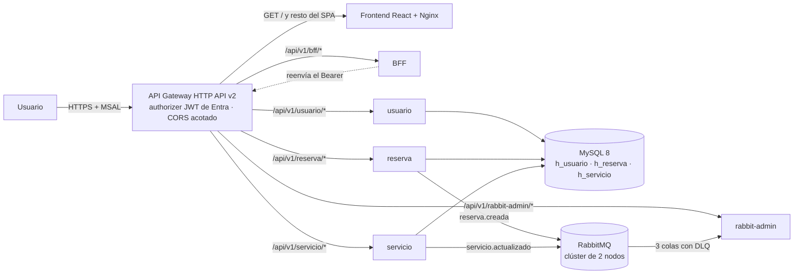

# CloudNative01 — Sistema Hotelero (DSY1107)

Plataforma de gestión hotelera construida con microservicios Spring Boot 4, frontend React 19 con MSAL, MySQL 8 y RabbitMQ. El despliegue en AWS usa Terraform, API Gateway con authorizer JWT de Entra ID y un BFF para las vistas que agregan dominios.

> **Estado actual:** EP1 y EP2 completas. EP3 (Kafka) en preparación. El sistema tiene 148 tests declarados, RabbitMQ en clúster de 2 nodos y frontend público por el API Gateway.

> **Documentación interna:** los guiones de demo, capturas y evidencias de trabajo se mantienen fuera del repositorio. Este README describe lo que está implementado y cómo se ejecuta.

## 1. Arquitectura

### 1.1 Vista general



Cada microservicio es dueño de su base (`h_usuario`, `h_reserva`, `h_servicio`) dentro de una única instancia MySQL 8.

### 1.2 Componentes y puertos

| Capa | Tecnología | Puerto |
|------|-----------|--------|
| Frontend | React 19 + Vite 8 + MSAL | `5173` dev · `80` EC2 · gateway HTTPS público |
| Microservicio usuario | Spring Boot 4.1.1 + OAuth2 Resource Server | `8083` |
| Microservicio reserva | Spring Boot 4.1.1 + OAuth2 Resource Server | `8081` |
| Microservicio servicio | Spring Boot 4.1.1 + OAuth2 Resource Server | `8082` |
| BFF | Spring Boot 4.1.1 + OAuth2 Resource Server | `8084` |
| rabbit-admin | Spring Boot 4.1.1 + OAuth2 Resource Server + Spring AMQP | `8085` |
| RabbitMQ | Clúster de 2 nodos (`rabbitmq:4.2-management`) | `5672` AMQP · `15672` dashboard |
| Base de datos | MySQL 8 (Docker en local · nativa en la EC2 de usuario) | `3306` |

Cada microservicio lee su configuración por variables de entorno, con defaults en `application.properties` o `application.yml`. La validación JWT usa el issuer del tenant de Entra ID y la audience del client ID de la aplicación.

### 1.3 Flujo de una solicitud

1. El usuario abre el SPA por el gateway e inicia sesión con MSAL contra Entra ID.
2. El navegador llama al API Gateway con `Authorization: Bearer`. El SPA y la API comparten origen.
3. El gateway valida el token y enruta `/api/v1/{micro}/…` al microservicio correspondiente.
4. El microservicio revalida el token, aplica el rol con `@PreAuthorize` y ejecuta la regla de negocio.
5. Persiste en su base y, si corresponde, publica el evento al broker con confirmación y fail-safe.
6. La respuesta vuelve al navegador. Si la vista agrega varios dominios, el BFF compone la respuesta.

### 1.4 Seguridad

- **OAuth2/JWT con Entra ID:** MSAL en el frontend y OAuth2 Resource Server en los 5 microservicios.
- **Doble validación:** el gateway valida firma, `iss` y `aud`, y cada microservicio revalida el token.
- **Autorización por rol:** el claim `roles` se aplica con `@PreAuthorize`. Las escrituras quedan reservadas a `ADMIN` y los errores se normalizan como `401 AUTH-001` o `403 AUTH-003`.
- **CORS acotado:** orígenes por variable `CORS_ORIGINS`, con métodos y cabeceras explícitos, tanto en el gateway como en los microservicios.
- **Superficie mínima:** el navegador solo conoce el API Gateway. Los `.env` reales no se versionan y las credenciales de laboratorio no son de producción.

## 2. Estructura del repositorio

```text
├── Frontend/            # React 19 + Vite + MSAL
│   └── src/
│       ├── auth/        # MSAL, interceptor HTTP y RequireAuth
│       ├── components/  # Tarjeta, formulario y modificación de servicios
│       ├── pages/       # Inicio, Login, Servicios, Reservas, Mi cuenta, Panel admin
│       ├── routes/      # RouterConfig con rutas protegidas
│       ├── services/    # servicioService y bffService
│       └── utils/       # environment.ts
├── usuario/             # Microservicio de usuarios (:8083)
├── reserva/             # Microservicio de reservas (:8081)
├── servicio/            # Microservicio de servicios (:8082)
├── bff/                 # BFF del frontend (:8084)
├── rabbit-admin/        # Administración RabbitMQ y consumidores (:8085)
├── db-init/             # init.sql con las bases h_usuario, h_reserva y h_servicio
├── seeds/               # Seeds idempotentes de usuarios y servicios
├── infra/               # Terraform AWS y compose del clúster RabbitMQ
├── docker-compose.yml   # MySQL 8 local con volumen persistente
├── .github/workflows/   # CI de tests, frontend y Terraform
└── .env.example         # Plantilla de variables de entorno
```

## 3. Puesta en marcha local

### 3.1 Requisitos

- Docker Desktop para MySQL o un MySQL 8.0 local en `localhost:3306`.
- Java 21. Los microservicios compilan a bytecode 21.
- Node.js 20.19+ o 22.12+ para Vite 8.
- Una cuenta del tenant de Entra ID del curso.

### 3.2 Base de datos

```bash
docker compose up -d
```

Levanta `hotel-mysql` con usuario `root` y contraseña `root`. En la primera inicialización ejecuta `db-init/init.sql` y crea las bases `h_usuario`, `h_reserva` y `h_servicio`.

Las tablas las crea Hibernate con `ddl-auto=update` al arrancar cada microservicio. Los seeds se aplican después del primer arranque y son idempotentes:

```bash
docker exec -i hotel-mysql mysql -uroot -proot < seeds/seed_usuarios.sql
docker exec -i hotel-mysql mysql -uroot -proot < seeds/seed_servicios.sql
```

En PowerShell la redirección `<` no existe. Usa `cmd`:

```powershell
cmd /c "docker exec -i hotel-mysql mysql -uroot -proot < seeds\seed_usuarios.sql"
cmd /c "docker exec -i hotel-mysql mysql -uroot -proot < seeds\seed_servicios.sql"
```

### 3.3 Microservicios

```bash
cd usuario && .\mvnw.cmd package -DskipTests
java -jar target\usuario-0.0.1-SNAPSHOT.jar
```

```bash
cd reserva && .\mvnw.cmd package -DskipTests
java -jar target\reserva-0.0.1-SNAPSHOT.jar
```

```bash
cd servicio && .\mvnw.cmd package -DskipTests
java -jar target\servicio-0.0.1-SNAPSHOT.jar
```

```bash
cd bff && mvn package -DskipTests
java -jar target\bff-0.0.1-SNAPSHOT.jar
```

```bash
cd rabbit-admin && mvn package -DskipTests
java -jar target\rabbit-admin-0.0.1-SNAPSHOT.jar
```

`usuario`, `reserva` y `servicio` traen wrapper de Maven. `bff` y `rabbit-admin` usan Maven global 3.9.14.

Variables principales:

| Variable | Default | Uso |
|----------|---------|-----|
| `DB_HOST` / `DB_PORT` | `localhost` / `3306` | Servidor MySQL |
| `DB_NAME` | `h_usuario` / `h_reserva` / `h_servicio` | Base de cada microservicio |
| `DB_USERNAME` / `DB_PASSWORD` | `root` / vacío | Credenciales MySQL |
| `SERVER_PORT` | `8083` / `8081` / `8082` / `8084` / `8085` | Puerto del API |
| `AZURE_TENANT_ID` | tenant del curso | Emisor del JWT |
| `AZURE_AUDIENCE` | client ID de la app | Audience del JWT |
| `RABBITMQ_*` | `localhost` / `5672` | Broker AMQP |

Si MySQL exige contraseña y el jar arranca sin `DB_PASSWORD`, el arranque falla con `Access denied using password: NO`:

```powershell
$env:DB_PASSWORD = "root"
java -jar target\usuario-0.0.1-SNAPSHOT.jar
```

Si `java -version` muestra una versión menor a 21, usa el JDK 21 explícito o deja ese JDK primero en el PATH. De lo contrario aparece `UnsupportedClassVersionError`.

### 3.4 Frontend

```bash
cd Frontend
npm install
npm run dev
```

Abrir [http://localhost:5173](http://localhost:5173). El `redirectUri` de MSAL es el origen actual y está registrado en Entra para localhost y para la URL pública del gateway. El client ID y el tenant viven en `Frontend/src/utils/environment.ts`. La URL del API se define con `VITE_API_BASE_URL` (ver `Frontend/.env.example`).

> **Variable obligatoria:** `VITE_API_BASE_URL` no tiene fallback. El build de producción falla si falta. En local se define en `Frontend/.env` o en la sesión antes de ejecutar Vite.

> **Frontend en la nube:** el `dist` se sirve por nginx en la EC2 y, como vía pública, por el mismo API Gateway. MSAL exige contexto seguro, así que la URL oficial es la del gateway HTTPS y no el HTTP directo de la EC2. Su redirect URI debe estar registrado en Entra junto al de localhost.

La URL pública se obtiene con:

```bash
terraform -chdir=infra output -raw api_url
```

Build de producción:

```powershell
$env:VITE_API_BASE_URL = terraform -chdir=infra output -raw api_url
cd Frontend
npm run build
```

Accesos locales:

| Recurso | Dónde |
|---------|-------|
| Frontend dev | `http://localhost:5173` |
| usuario · reserva · servicio · bff · rabbit-admin | `:8083` · `:8081` · `:8082` · `:8084` · `:8085` |
| MySQL local | `localhost:3306` (`hotel-mysql`, root/root) |
| Broker de tests | `localhost:5680` (`cn-rabbit-audit`, hotel/hotel123) |
| Swagger rabbit-admin | `http://localhost:8085/swagger-ui/index.html` |

### 3.5 RabbitMQ local para tests

Los tests de integración usan un RabbitMQ aparte en `localhost:5680`:

```bash
docker run -d --name cn-rabbit-audit -p 5680:5672 -p 15680:15672 -e RABBITMQ_DEFAULT_USER=hotel -e RABBITMQ_DEFAULT_PASS=hotel123 rabbitmq:4.2-management
```

Sin ese contenedor, los tests de integración con broker se omiten solos. Los unitarios y los tests de contexto corren igual.

## 4. Uso del sistema

### 4.1 Login y roles

| Cuenta | Rol | Acceso |
|--------|-----|--------|
| `admin.prueba@tenaninternoemihormazabal.onmicrosoft.com` | Admin | Panel de administración y CRUD de servicios |
| `cliente.prueba@tenaninternoemihormazabal.onmicrosoft.com` | Cliente | Lectura de servicios y de sus reservas |

Las cuentas son de laboratorio y se crean en Entra ID. La fila local del usuario nace en el primer acceso a `/me`.

### 4.2 Rutas del frontend

| Ruta | Vista | Requiere |
|------|-------|----------|
| `/` | Inicio | Público |
| `/registro` | Registro | Pendiente, placeholder sin enlace |
| `/login` | Iniciar o cerrar sesión | Público |
| `/servicios` | Listado de servicios | Autenticado |
| `/servicios/detalle` | Detalle de servicio | Autenticado |
| `/mi_cuenta` | Datos del JWT y resumen del BFF | Autenticado |
| `/mis_reservas` | Reservas del usuario | Autenticado |
| `/mis_reservas/detalle` | Detalle de reserva | Autenticado |
| `/PanelAdministradores` | Panel de servicios | Rol `Admin` |

Un usuario autenticado sin rol `Admin` que entra al panel ve “Acceso denegado”. Un usuario no autenticado es redirigido a `/login` desde cualquier ruta protegida.

### 4.3 Flujo de uso

1. Abrir el frontend y entrar con una cuenta demo.
2. En `/mi_cuenta` se muestran correo, rol, scopes y el resumen del BFF.
3. En `/servicios` se ve el catálogo cargado desde la API.
4. Como Admin se puede crear, editar y eliminar servicios.
5. Como Cliente se ven los servicios y las reservas propias.
6. Cerrar sesión desde la barra superior.

El alta de reservas es una operación de administración (`POST /reserva` exige `ADMIN`). El cliente puede consultar sus reservas, pero no crearlas desde la interfaz.

## 5. API

Todos los endpoints requieren un JWT de Entra ID válido. Sin token responden `401` y con rol insuficiente responden `403`. Las escrituras usan `@PreAuthorize` y quedan reservadas a `ADMIN`.

Los POST y PUT de `reserva`, `servicio` y `rabbit-admin`, y el PUT de `usuario`, validan la entrada. Campos inválidos responden `400 VALID-001` con detalle por campo. Un JSON malformado responde `400 VALID-002`.

### 5.1 Microservicio usuario

`http://localhost:8083/api/v1/usuario`

| Método | Ruta | Descripción | Rol |
|--------|------|-------------|-----|
| GET | `/me` | Usuario autenticado resuelto por token | Autenticado |
| GET | `/get/{id}` | Usuario por id | ADMIN |
| GET | `/list` | Listar usuarios | ADMIN |
| PUT | `/put/{id}` | Actualizar usuario | ADMIN |
| DELETE | `/delete/{id}` | Eliminar usuario | ADMIN |

### 5.2 Microservicio reserva

`http://localhost:8081/api/v1/reserva`

| Método | Ruta | Descripción | Rol |
|--------|------|-------------|-----|
| POST | `/post` | Crear reserva | ADMIN |
| GET | `/get/{id}` | Reserva por id | Autenticado |
| GET | `/list` | Listar reservas | Autenticado |
| GET | `/usuario/{idUsuario}` | Reservas de un usuario | Autenticado |
| PUT | `/put/{id}` | Actualizar reserva | ADMIN |
| DELETE | `/delete/{id}` | Eliminar reserva | ADMIN |

### 5.3 Microservicio servicio

`http://localhost:8082/api/v1/servicio`

| Método | Ruta | Descripción | Rol |
|--------|------|-------------|-----|
| POST | `/post` | Crear servicio | ADMIN |
| GET | `/get/{id}` | Servicio por id | Autenticado |
| GET | `/list` | Listar servicios | Autenticado |
| PUT | `/put/{id}` | Actualizar servicio | ADMIN |
| DELETE | `/delete/{id}` | Eliminar servicio | ADMIN |

### 5.4 BFF

`http://localhost:8084/api/v1/bff`

| Método | Ruta | Descripción | Rol |
|--------|------|-------------|-----|
| GET | `/dashboard` | Usuario, reservas y catálogo de servicios | Autenticado |
| GET | `/admin/resumen` | Resumen global de usuarios, reservas y servicios | ADMIN |

### 5.5 Administrador RabbitMQ

`http://localhost:8085/api/v1/rabbit-admin`

| Método | Ruta | Descripción | Rol |
|--------|------|-------------|-----|
| POST | `/queues` | Crear cola durable | ADMIN |
| GET | `/queues/{nombre}` | Info de cola | Autenticado |
| DELETE | `/queues/{nombre}` | Eliminar cola | ADMIN |
| POST | `/queues/{nombre}/purge` | Vaciar cola | ADMIN |
| POST | `/exchanges` | Crear exchange direct o topic | ADMIN |
| DELETE | `/exchanges/{nombre}` | Eliminar exchange | ADMIN |
| POST | `/bindings` | Crear binding cola-exchange | ADMIN |
| POST | `/publish` | Publicar mensaje de prueba | ADMIN |

`rabbit-admin` expone Swagger UI en `/swagger-ui/index.html` y `/v3/api-docs` sin token. La API de administración sigue exigiendo JWT.

## 6. Mensajería RabbitMQ (EP2)

### 6.1 Topología

La topología la declara únicamente `rabbit-admin` al arrancar. Es idempotente.

| Cola | DLQ | Binding | Evento |
|------|-----|---------|--------|
| `notificaciones.queue` | `notificaciones.dlq` | `hotel.topic` ← `reserva.*` | `reserva.creada` |
| `tickets.queue` | `tickets.dlq` | `hotel.topic` ← `reserva.creada` y `hotel.direct` ← `ticket.generar` | `reserva.creada` |
| `documentos.queue` | `documentos.dlq` | `hotel.topic` ← `servicio.*` | `servicio.actualizado` |

Todos los exchanges y colas son durables. Las colas derivan a su DLQ por `hotel.dlx` y cada DLQ retiene mensajes 24 h con `x-message-ttl`.

La alerta de DLQ consulta la profundidad de las 3 DLQ directo al broker, con `rabbitmqctl` o la API de administración, para detectar mensajes no entregados.

### 6.2 ACK y errores

- Éxito: `basicAck`.
- Evento inválido: `basicNack(false, false)`, DLQ directa.
- Fallo recuperable: `basicNack(false, true)`, un reintento. Si la reentrega falla, `basicNack(false, false)` y DLQ.
- Los eventos viajan como JSON con `JacksonJsonMessageConverter`.
- Los productores de `reserva` y `servicio` son fail-safe. Si RabbitMQ cae, la operación de negocio no se pierde.
- Las publicaciones usan `publisher confirms + returns` en modo `correlated` y `PublicacionObservable` registra confirmaciones y devoluciones.

### 6.3 Dashboard y demo

Para la demo, el dashboard se abre por IP pública:

```text
http://<IP_PUBLICA_DE_cn-rabbit>:15672
Usuario: hotel
Contraseña: hotel
```

El túnel SSH queda como respaldo:

```bash
ssh -i <llave>.pem -L 15672:localhost:15672 ec2-user@<IP_PUBLICA_DE_cn-rabbit>
```

Los puertos 15672 y 8080 se abren solo durante la demo. 5672 y 9092-9094 quedan internos. El 8080 queda reservado para la Kafka UI de EP3.

## 7. Pruebas y calidad

### 7.1 Comandos

```bash
.\mvnw.cmd test     # usuario, reserva y servicio
mvn test            # bff y rabbit-admin
npm run lint        # Frontend
npm run build       # Frontend
```

### 7.2 Cobertura y análisis

El proyecto declara **148 tests**: usuario 28, reserva 29, servicio 30, bff 14 y rabbit-admin 47. Incluyen arranque de contexto, mapeo de claims JWT a roles, control de acceso, validación de entrada, CRUD, BFF y mensajería.

Sin el broker de tests en `localhost:5680` se ejecutan 133 tests. Los 15 de integración con Rabbit se omiten por diseño. Con `cn-rabbit-audit` corriendo se ejecutan los 148.

La cobertura se mide con JaCoCo en los 5 módulos. El reporte HTML queda en `target/site/jacoco/`. La última corrida local sin broker dejó 69,9% de líneas y 62,1% de ramas. La referencia de EP2 con el broker de tests levantado era 74,6% y 75,9%.

El análisis estático de EP2 dejó 70 avisos de convenciones deliberadas y 0 Security Hotspots. Los detalles históricos están en las evidencias de la entrega.

## 8. Infraestructura AWS

### 8.1 Terraform

`infra/main.tf` despliega en `us-east-1`, en una VPC propia con subred pública:

```text
Navegador (MSAL → Entra ID)
   │ HTTPS + Bearer JWT
   ▼
API Gateway HTTP API v2 · JWT authorizer Entra · CORS acotado · logs 30 días
   │ sirve el SPA en / · enruta /api/v1/{micro}/… a cada microservicio
   ▼
VPC 10.0.0.0/16 (subred pública, 7 EC2 t2.micro AL2023)
   ├─ cn-frontend       nginx + dist React · Elastic IP
   ├─ cn-usuario        :8083 microservicio + MySQL 8
   ├─ cn-reserva        :8081 publica reserva.creada
   ├─ cn-servicio       :8082 publica servicio.actualizado
   ├─ cn-bff            :8084 agrega datos vía gateway
   ├─ cn-rabbit         clúster RabbitMQ de 2 nodos
   └─ cn-rabbit-admin   :8085 admin REST + 3 consumidores
```

- 7 EC2 `t2.micro` AL2023 con el keypair `cloudnative-labs`. La llave pública vive en `infra/keys/`, la privada no se versiona.
- Security Group: 80 y 8081-8085 públicos, 22 con llave, 3306 y 5672 solo entre EC2 del grupo. 15672 y 8080 se abren solo para la demo.
- API Gateway HTTP API v2 con authorizer JWT de Entra, CORS, rutas `OPTIONS` sin auth y logs en CloudWatch.
- El frontend usa Elastic IP para mantener su URL y su CORS estables entre sesiones del laboratorio.

### 8.2 Despliegue

```bash
cd infra
terraform init
terraform plan
terraform apply
```

Credenciales de laboratorio: RabbitMQ `hotel` / `hotel`. MySQL usa la contraseña definida en `infra/terraform.tfvars`, que está ignorado por Git. La contraseña de MySQL y el AMI viven en ese archivo.

Después del apply:

1. Subir los 5 jars a `/opt/apps/` y arrancar los servicios `cn-*` con `systemctl`.
2. Copiar `infra/rabbit-cluster/` a `cn-rabbit`, crear `.env` con `RABBIT_COOKIE=cloudnativecookie`, `RABBIT_USER=hotel` y `RABBIT_PASS=hotel`, ejecutar `docker compose --env-file .env up -d` y luego `bash unirse-cluster.sh`.
3. Aplicar los seeds de MySQL y subir `dist/` del frontend a `/var/www/grandhotel` con `sudo chmod -R a+rX /var/www/grandhotel`.
4. Orden de arranque: broker, `rabbit-admin` para declarar la topología, `reserva` y `servicio` como productores, y el resto de microservicios.

### 8.3 Demo y operación

La URL del gateway se obtiene con `terraform -chdir=infra output -raw api_url`. Las IPs se leen de Terraform, nunca se copian a mano. Un apply refresca las integrations del gateway y el CORS.

Si el gateway se recrea, hay que recompilar el `dist` con la nueva URL y actualizar el redirect URI en Entra (Authentication → SPA). El HTTP directo de la EC2 no sirve para MSAL porque exige contexto seguro.

En AWS Academy el laboratorio se corta a las 4 horas y detiene las EC2. Al volver hay que arrancarlas y verificar que las 7 estén `running` antes de aplicar. Con las EC2 detenidas, el plan puede mostrar un destroy falso que no se debe aplicar. Al cierre: `terraform destroy`.

El gasto real se consulta en el panel Vocareum. Al 05-nov el laboratorio usado ronda $12,9 de $50. El encendido de las 7 EC2 y la Elastic IP tienen costo mientras estén activos.

## 9. Credenciales y seguridad

- Las claves públicas de Entra ID viven en `Frontend/src/utils/environment.ts`. El issuer y la audience se configuran por variables de entorno en cada microservicio.
- No hay secretos de producción en el repositorio.
- Las credenciales de laboratorio son RabbitMQ `hotel`/`hotel` y la contraseña de MySQL definida en `infra/terraform.tfvars`. No deben reutilizarse fuera del laboratorio.
- `.env.example` es la plantilla de los microservicios y `Frontend/.env.example` la del frontend. Los `.env` reales no se suben.
- El `.gitignore` excluye `.env`, `node_modules`, `target/`, `*.log`, credenciales privadas, documentación interna y artefactos locales. `infra/.gitignore` excluye `.terraform/`, `.tfstate`, `.tfvars` y planes.

## 10. Cumplimiento EP1 y EP2

| Evaluación | Evidencia principal |
|------------|---------------------|
| EP1 MSAL | Login/logout con Entra ID, guard por autenticación y rol, Bearer automático y roles leídos del JWT |
| EP1 BFF | `bff` valida JWT, aplica roles y compone usuario, reservas y catálogo por el gateway |
| EP2 centralización | Topología RabbitMQ en `application.yml` y `RabbitMqConfig` |
| EP2 separación | `rabbit-admin` concentra la administración AMQP y los consumidores por dominio |
| EP2 ACK y DLQ | ACK manual, NACK con un reintento, DLQ directa y TTL de 24 h |
| EP2 productores | `reserva` y `servicio` publican con fail-safe, confirms y returns |
| EP2 admin REST | CRUD de colas, exchanges, bindings y publicación de prueba con DTOs validados |
| EP2 clúster | 2 nodos RabbitMQ en `cn-rabbit` con docker compose |
| Pruebas | 148 tests declarados, cobertura JaCoCo y análisis estático de EP2 |
| CI | Workflow de GitHub Actions con tests, frontend y validación de Terraform |

## 11. Mejoras evaluadas

| Mejora | Decisión |
|--------|----------|
| Outbox transaccional en productores | Diferida. El fail-safe, confirms y returns cubren el requisito de EP2 |
| Versionado de eventos y `X-Correlation-Id` | Diferida |
| Endpoints múltiples del broker | Diferida. Ambos nodos viven en la misma EC2 |
| Bandeja de notificaciones persistente | Fuera del alcance de EP2 |
| Paginación en `GET /list` | Sin caso real con los volúmenes actuales |
| Idempotencia en consumidores | Sin efecto real hoy. Los consumidores registran en logs |
| Flyway | Diferida. Hibernate cubre el esquema actual |
| CI con GitHub Actions | Implementado para build, tests, frontend y validación de Terraform |
| CD automático | Diferido. El despliegue manual está documentado y verificado |
| `/registro` funcional | Descartada. La gestión de usuarios corresponde a Entra ID |
| Kafka y EP3 | En preparación |
