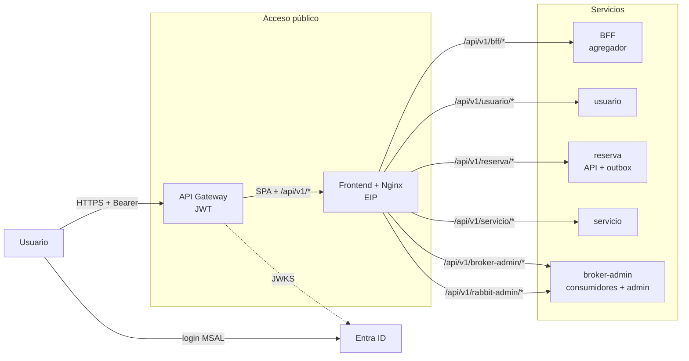
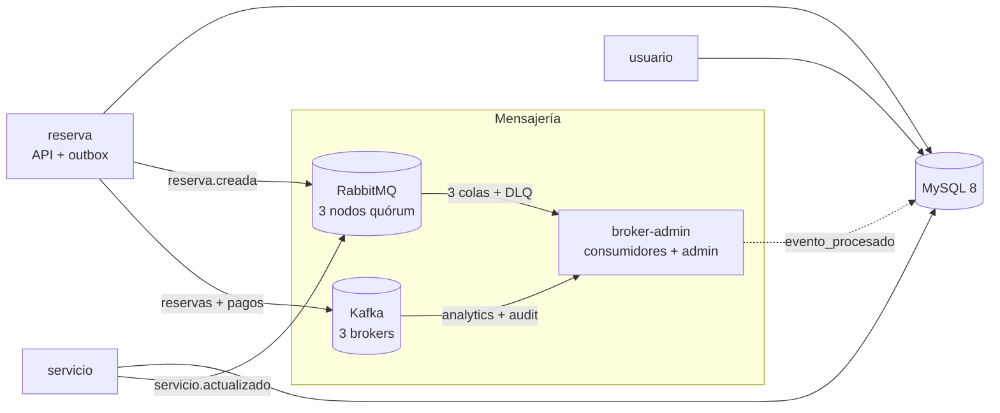

# CloudNative01 - Sistema Hotelero (DSY1107)

Plataforma hotelera con microservicios Spring Boot 4, frontend React 19 con MSAL,
MySQL 8, RabbitMQ de 3 nodos y Kafka de 3 brokers. El despliegue cloud usa
Terraform, API Gateway HTTP con JWT de Entra ID, frontend con Nginx y un BFF que
agrega dominios. API Gateway usa la EIP estable del frontend y Nginx enruta las
rutas API hacia las IPs privadas de los microservicios.

> **Estado:** EP1, EP2 y EP3 implementados. La evaluación final incluye RabbitMQ,
> Kafka, administración de mensajería, pruebas automatizadas y manejo de fallos.
>
> **Entrega EV3:** 16-nov-2026 12:00 UTC-3.
> **Presentación:** 16-nov-2026 14:40 UTC-3.
>
> **Actualización:** 16-nov-2026.
>
> **Frontend:** React 19 fue autorizado por el docente para EV1, EV2 y EV3. La
> referencia académica menciona Angular, pero el docente aprobó React.

## 1. Alcance

- **Alcance:** ADMIN crea la reserva y confirma el pago, CLIENTE consulta sus
  reservas, el dashboard y los servicios. El autoservicio del Cliente no forma
  parte del alcance actual.
- La UI no tiene formulario de creación de reserva ni de pago. Esas operaciones
  se ejecutan por API con un token `ADMIN` y luego se reflejan en la UI.
- El frontend consume datos reales del API Gateway y del BFF, no usa datos simulados (mocks).
- La mensajería se demuestra con RabbitMQ, Kafka, sus UIs y los endpoints de
  administración de `broker-admin`.

## 2. Arquitectura

#### Flujo de solicitud



El BFF aparece como agregador del frontend. En cloud consulta API Gateway con el
mismo `Bearer`, en local consulta las URLs directas de los servicios. Esa llamada
se omite del dibujo para evitar un ciclo visual.

#### Flujo de eventos y datos



| Ruta pública | Destino interno | Autorización |
|---|---|---|
| `GET /` | Frontend React | NONE |
| `GET /{proxy+}` | Frontend React | NONE |
| `/api/v1/bff/*` | BFF | JWT |
| `/api/v1/usuario/*` | usuario | JWT |
| `/api/v1/reserva/*` | reserva | JWT |
| `/api/v1/servicio/*` | servicio | JWT |
| `/api/v1/broker-admin/*` | broker-admin | JWT |
| `/api/v1/rabbit-admin/*` | broker-admin (alias) | JWT |
| `OPTIONS /api/v1/*` | Servicio correspondiente | NONE |

El BFF reutiliza API Gateway con el token `Bearer` para agregar usuario, reservas
y servicios. En cloud usa `MICROSERVICIOS_*_URL` apuntando al API Gateway. En
local usa las URLs directas de los servicios. API Gateway no integra directamente
con las IPs públicas de los microservicios. Sus integraciones apuntan a la EIP
del frontend. Nginx recibe `/api/v1/*` y hace proxy a las IPs privadas, que
permanecen estables cuando las EC2 se detienen y vuelven a iniciar.

### Lectura rápida

- El usuario inicia sesión en Entra ID y API Gateway valida el JWT.
- API Gateway sirve la SPA y las rutas API a través de la EIP del frontend.
- Nginx sirve la SPA y hace proxy de `/api/v1/*` a los servicios.
- `reserva` persiste y publica por outbox, `servicio` publica directo a Rabbit.
- `broker-admin` consume Rabbit y Kafka y registra la deduplicación en MySQL.

### Componentes

| Componente | Tecnología | Puerto |
|---|---|---|
| Frontend | React 19 + Vite 8 + MSAL + Nginx | `80` EC2, EIP y gateway HTTPS |
| usuario | Spring Boot 4.1.1 + OAuth2 | `8083` |
| reserva | Spring Boot 4.1.1 + OAuth2 | `8081` |
| servicio | Spring Boot 4.1.1 + OAuth2 | `8082` |
| BFF | Spring Boot 4.1.1 + OAuth2 | `8084` |
| broker-admin | Spring Boot 4.1.1 + AMQP + Kafka Admin | `8085` |
| RabbitMQ | 3 nodos cloud, colas quórum y gestión | `5672` interno, `15672` público |
| Kafka | 3 Zookeeper + 3 brokers + Kafka UI | `9092-9094` interno, `8080` público |
| MySQL | MySQL 8 en EC2 usuario | `3306` interno |

### Límites de la arquitectura de laboratorio

- Los 3 brokers Kafka, los 3 Zookeeper y Kafka UI corren en una sola EC2
  (`cn-kafka`). Hay redundancia de procesos, no de host ni de zona.
- Rabbit3 comparte host con Kafka. Si se detiene `cn-kafka`, también se detiene
  el tercer nodo de Rabbit.
- Toda la infraestructura está en una sola subred y una sola zona de
  disponibilidad. No hay ALB, Auto Scaling, réplica de MySQL ni backup
  automático.
- Kafka UI no tiene autenticación. Rabbit UI usa credenciales de laboratorio.
- El frontend y MySQL son instancias únicas.

### Flujo de una solicitud

1. El navegador inicia sesión con MSAL contra Entra ID.
2. El frontend llama al API Gateway con `Authorization: Bearer`.
3. El autorizador (authorizer) valida firma, emisor y audiencia.
4. El gateway enruta `/api/v1/...` a la EIP estable del frontend.
5. Nginx recibe la ruta y hace proxy al microservicio interno correspondiente.
6. El microservicio revalida el token y aplica `@PreAuthorize`.
7. El servicio persiste en su base. `reserva` registra el evento en su outbox,
   `servicio` publica directo a Rabbit.
8. El proceso de publicación (relay) del servicio de reservas envía el evento a
   RabbitMQ y Kafka.
9. Rabbit/Kafka alimentan a `broker-admin`, que expone métricas, DLT y
   administración.

## 3. Estructura

```text
├── Frontend/            React, MSAL, páginas, servicios y pruebas
├── usuario/             Usuarios y MySQL (:8083)
├── reserva/             Reservas, pagos, idempotencia, outbox (:8081)
├── servicio/            Catálogo de servicios (:8082)
├── bff/                 Agregación para el frontend (:8084)
├── broker-admin/        Admin Rabbit/Kafka, consumidores y DLT (:8085)
├── infra/               Terraform AWS, clusters y Nginx local/cloud
├── contracts/           Contrato compartido de eventos
├── db-init/             Bases MySQL locales
└── .github/workflows/   CI de backend, frontend y Terraform
```

El despliegue cloud crea **9 EC2**:

| EC2 | Función |
|---|---|
| `cn-frontend` | SPA, Nginx y proxy API/UI, EIP estable |
| `cn-usuario` | Microservicio usuario y MySQL |
| `cn-reserva` | Microservicio reserva |
| `cn-servicio` | Microservicio servicio |
| `cn-bff` | BFF |
| `cn-rabbit` | Rabbit nodo 1 |
| `cn-rabbit2` | Rabbit nodo 2 |
| `cn-kafka` | Kafka, Zookeeper, Kafka UI y Rabbit nodo 3 |
| `cn-broker-admin` | broker-admin |

## 4. Ejecución local

### Requisitos

- Windows con PowerShell.
- Java 21.
- Maven 3.9.16 o los wrappers incluidos en `usuario`, `reserva` y `servicio`.
- Node.js 20.19+ o 22.12+.
- Docker Desktop.
- Acceso al tenant de Entra ID.

### 4.1 MySQL local

```powershell
Copy-Item .env.example .env
docker compose up -d
$env:DB_PASSWORD = "root"
```

`docker compose` usa `MYSQL_ROOT_PASSWORD` del `.env`. Los servicios usan
`DB_PASSWORD` en su propia terminal. El compose crea `h_usuario`, `h_reserva` y
`h_servicio`. `h_broker_admin` se crea automáticamente al iniciar `broker-admin`.
El proyecto Compose es `cn-dev-db` y usa el volumen `cn-dev-db_mysql_data`.

### 4.2 RabbitMQ local opcional

Para demostrar el clúster local de 2 nodos:

```powershell
docker compose -f infra/rabbit-cluster/docker-compose.cluster.yml up -d
docker exec cn-dev-rabbit-2 rabbitmqctl stop_app
docker exec cn-dev-rabbit-2 rabbitmqctl join_cluster rabbit@rabbit-local1
docker exec cn-dev-rabbit-2 rabbitmqctl start_app
docker exec cn-dev-rabbit-1 rabbitmqctl cluster_status
```

- Rabbit UI local: `http://localhost:15673`.
- Rabbit AMQP local: `localhost:5673`.
- Credenciales: las definidas en `infra/rabbit-cluster/docker-compose.cluster.yml`.
- Los servicios deben usar `RABBITMQ_PORT=5673`, el valor por defecto es `5672`.

El clúster (cluster) local de 2 nodos sirve para demostrar la topología. No es
HA: el quórum (quorum) de negocio es de 3 miembros y el clúster cloud de 3 nodos
es el que tolera la caída de un nodo.

### 4.3 Kafka local opcional

```powershell
$env:KAFKA_ADVERTISED_HOST = "localhost"
$env:KAFKA_UI_PORT = "18080"
docker compose -f infra/kafka/docker-compose.yml up -d
```

- Kafka UI local: `http://localhost:18080`.
- Brokers: `localhost:9092`, `9093` y `9094`.
- Clúster de Kafka UI: `grand-hotel`.
- Kafka UI no tiene autenticación, es solo para laboratorio.
- `KAFKA_AUTO_CREATE_TOPICS_ENABLE=false`, los topics los crea `broker-admin`.
- El puerto `8080` está reservado por Windows, por eso el UI local usa `18080`.

### 4.4 Compilación del backend

La compilación (build) se ejecuta por módulo.

```powershell
cd usuario
.\mvnw.cmd package -DskipTests
cd ..\reserva
.\mvnw.cmd package -DskipTests
cd ..\servicio
.\mvnw.cmd package -DskipTests
cd ..\bff
mvn package -DskipTests
cd ..\broker-admin
mvn package -DskipTests
```

### 4.5 Arranque local de servicios

Para el arranque completo usar la sección 4.7. Si se arranca manualmente, cada
servicio necesita su propio `SERVER_PORT`:

| Servicio | Puerto |
|---|---:|
| reserva | `18081` |
| servicio | `18082` |
| usuario | `18083` |
| bff | `18084` |
| broker-admin | `18085` |

Los servicios usan `localhost` para MySQL, Rabbit y Kafka. El modo completo de
4.7 configura las variables de Rabbit, Kafka y CORS.

### 4.6 Frontend local

```powershell
cd Frontend
npm ci
$env:VITE_API_BASE_URL = "https://<api-id>.execute-api.us-east-1.amazonaws.com"
npm run dev
```

La UI completa necesita un proxy para las rutas `/api/v1/*`:

- `/api/v1/bff/dashboard`, para reservas, cuenta y panel.
- `/api/v1/servicio/*`, para el catálogo.
- `/api/v1/broker-admin/*`, para el panel de mensajería.
- `/api/v1/usuario/*`, para la sesión.

No existe una llamada directa del frontend a `/api/v1/reserva`, las reservas se
leen a través del BFF. El BFF local solo expone `/api/v1/bff/dashboard` y
`/api/v1/bff/admin/resumen`. El modo local completo de la sección 4.7 incluye el
proxy necesario, el arranque manual de Vite no lo incluye.

### 4.7 Modo local privado

El entorno local completo usa los grupos Docker `cn-dev-db`, `cn-dev-rabbit`,
`cn-dev-kafka` y `cn-dev-local`. El frontend se publica en
`http://localhost:5173`, Rabbit UI en `http://localhost:15673` y Kafka UI en
`http://localhost:18080`.

Los servicios locales usan `18081-18085`, porque Windows reserva el rango que
incluye `8081-8085`. Cloud sigue usando `8081-8085`.

El arranque automatizado y las instrucciones de operación local se mantienen
fuera del repositorio público. El proxy local reemplaza al API Gateway para esta
demo, pero no replica Terraform, EIP ni el API Gateway cloud. Entra ID sigue
siendo externo, con redirect `http://localhost:5173`.

## 5. Despliegue cloud

### 5.1 Terraform

```powershell
Copy-Item infra\terraform.tfvars.example infra\terraform.tfvars
# Completar ami_id y db_password en infra\terraform.tfvars.
terraform -chdir=infra init
terraform -chdir=infra plan -out="$env:TEMP\cloudnative.tfplan"
terraform -chdir=infra apply "$env:TEMP\cloudnative.tfplan"
```

El plan debe mostrar **0 to destroy**. `infra/terraform.tfvars` está ignorado por
Git y no debe contener valores publicados. El laboratorio AWS Academy detiene las
EC2 al agotar su ventana de uso de 4 horas, no ejecutar `terraform destroy` sin
autorización.

### 5.2 RabbitMQ cloud manual

Terraform crea las EC2 `cn-rabbit`, `cn-rabbit2` y `cn-kafka`, esta última aloja
`rabbit3`. Copiar `infra/rabbit-cluster` a `/home/ec2-user/rabbit-cluster` en los
tres hosts y crear un `.env` por nodo con:

```text
RABBIT_NODE=rabbit1|rabbit2|rabbit3
RABBIT1_IP=<rabbit1-private-ip>
RABBIT2_IP=<rabbit2-private-ip>
RABBIT3_IP=<kafka-private-ip>
RABBIT_COOKIE=<cookie-de-laboratorio>
RABBIT_USER=<rabbit-user>
RABBIT_PASS=<rabbit-password>
```

En cada host:

```bash
docker compose --env-file .env up -d
```

Unir los nodos desde `rabbit2` y `rabbit3`:

```bash
docker exec rabbit2 rabbitmqctl stop_app
docker exec rabbit2 rabbitmqctl join_cluster rabbit@rabbit1
docker exec rabbit2 rabbitmqctl start_app
docker exec rabbit3 rabbitmqctl stop_app
docker exec rabbit3 rabbitmqctl join_cluster rabbit@rabbit1
docker exec rabbit3 rabbitmqctl start_app
docker exec rabbit1 rabbitmqctl cluster_status
```

Si `cn-kafka` se detiene, Rabbit queda con 2 de 3 nodos y Kafka no está
disponible. Rabbit puede seguir operando con 2 nodos, pero el laboratorio pierde
la HA completa de Kafka.

### 5.3 Kafka cloud manual

Copiar `infra/kafka` a `/opt/kafka` en `cn-kafka` y crear `.env`:

```text
KAFKA_ADVERTISED_HOST=<kafka-private-ip>
```

Levantar el clúster:

```bash
cd /opt/kafka
docker compose --env-file .env up -d
```

Debe haber 3 Zookeeper, 3 brokers y Kafka UI. La UI se publica en
`http://<kafka-public-ip>:8080`, clúster `grand-hotel`.

Los 3 brokers y los 3 Zookeeper comparten la misma EC2. Kafka UI no tiene
autenticación y los brokers usan `PLAINTEXT`. Es una configuración de
laboratorio, en producción deben separarse hosts, agregar TLS/SASL y proteger
las UIs.

### 5.4 Servicios y base de broker-admin

Terraform crea las unidades systemd. Copiar cada JAR a `/opt/apps` y reiniciar:

| Servicio | JAR | EC2 | Unidad |
|---|---|---|---|
| usuario | `usuario-0.0.1-SNAPSHOT.jar` | `cn-usuario` | `cn-usuario` |
| reserva | `reserva-0.0.1-SNAPSHOT.jar` | `cn-reserva` | `cn-reserva` |
| servicio | `servicio-0.0.1-SNAPSHOT.jar` | `cn-servicio` | `cn-servicio` |
| bff | `bff-0.0.1-SNAPSHOT.jar` | `cn-bff` | `cn-bff` |
| broker-admin | `broker-admin-0.0.1-SNAPSHOT.jar` | `cn-broker-admin` | `cn-broker-admin` |

Plantilla de despliegue:

```powershell
$servicio = "reserva"
$ip = "<reserva-ip>"

scp -i <ssh-key> "$servicio\target\$servicio-0.0.1-SNAPSHOT.jar" `
  ec2-user@${ip}:/tmp/$servicio.jar

$jar = "/tmp/$servicio.jar"
$destino = "/opt/apps/$servicio-0.0.1-SNAPSHOT.jar"
ssh -i <ssh-key> ec2-user@$ip "sudo mv $jar $destino"
ssh -i <ssh-key> ec2-user@$ip "sudo systemctl restart cn-$servicio"
```

El servicio `cn-broker-admin` necesita un archivo de configuración adicional
(drop-in) para la base MySQL:

```bash
sudo mkdir -p /etc/systemd/system/cn-broker-admin.service.d
sudo tee /etc/systemd/system/cn-broker-admin.service.d/db.conf >/dev/null <<'EOF'
[Service]
Environment=DB_HOST=<mysql-private-ip>
Environment=DB_PORT=3306
Environment=DB_NAME=h_broker_admin
Environment=DB_USERNAME=admin
Environment=DB_PASSWORD=<db-password>
EOF
sudo systemctl daemon-reload
sudo systemctl restart cn-broker-admin
```

La aplicación crea `h_broker_admin` y la tabla `evento_procesado` al iniciar.

### 5.5 Frontend cloud

```powershell
cd Frontend
npm ci
$env:VITE_API_BASE_URL = (terraform -chdir=..\infra output -raw api_url)
npm run build
scp -i <ssh-key> -r dist\* ec2-user@<frontend-eip>:/var/www/grandhotel/
ssh -i <ssh-key> ec2-user@<frontend-eip> "sudo chmod -R a+rX /var/www/grandhotel"
```

### 5.6 Proxy Nginx de API y UIs

API Gateway apunta a la EIP del frontend. Terraform crea el Nginx estático de la
SPA. La plantilla versionada del proxy está en
`infra/cloud/nginx.conf.example`. Su aplicación sobre la EC2 es manual.
Reemplazar los placeholders `<...>` por las IPs privadas y aplicar:

```bash
sudo nginx -t
sudo systemctl reload nginx
```

Las rutas cubiertas son `/api/v1/bff`, `/api/v1/reserva`,
`/api/v1/servicio`, `/api/v1/usuario`, `/api/v1/broker-admin` y
`/api/v1/rabbit-admin`. Si se reemplaza la instancia frontend, se debe volver a
aplicar. La EIP y las IPs privadas de las EC2 se mantienen en un stop/start
normal, pero las IPs privadas pueden cambiar si se reemplazan las instancias.

### 5.7 Datos iniciales

`usuario` y `servicio` cargan datos iniciales (seeds) idempotentes al iniciar:

- `usuario/src/main/resources/data-mysql.sql`
- `servicio/src/main/resources/data-mysql.sql`

No se requiere SSH ni ejecutar SQL manualmente.

### 5.8 URLs y consideraciones

```powershell
terraform -chdir=infra output -raw api_url
terraform -chdir=infra output -raw frontend_public_ip
terraform -chdir=infra output -raw rabbit_public_ip
terraform -chdir=infra output -raw kafka_public_ip
```

- Frontend: URL HTTPS del API Gateway.
- Frontend directo: `http://<frontend-eip>` por el puerto 80.
- Rabbit UI estable: `http://<frontend-eip>:15672`.
- Kafka UI estable: `http://<frontend-eip>:8080`.
- Fallback directo: `http://<rabbit-public-ip>:15672` y
  `http://<kafka-public-ip>:8080`.

API Gateway integra contra la EIP del frontend, no contra las IPs públicas de
Rabbit, Kafka ni de los microservicios. Un stop/start normal conserva la EIP y
las IPs privadas. Las IPs públicas directas de todas las EC2 sin EIP pueden
cambiar al reiniciar el laboratorio, por eso se recomiendan las URLs estables
por la EIP.

No se deben reemplazar las integraciones de API Gateway por las IPs públicas de
Rabbit o Kafka. Si se reemplaza la instancia frontend, se debe reaplicar la
configuración Nginx de la sección 5.6. Las URLs estables de Rabbit UI y Kafka UI
dependen de ese proxy manual.

Rabbit UI usa credenciales de laboratorio. Kafka UI no tiene autenticación. Ambas
están publicadas por HTTP y son aceptables solo para la demo. En producción deben
quedar en red privada, detrás de SSO/VPN y TLS.

### 5.9 Reserva demo

1. Abrir el frontend por la URL HTTPS del gateway.
2. Iniciar sesión con un usuario del tenant.
3. Crear la reserva y confirmar el pago mediante la API con un token `ADMIN`.
4. Verificar la reserva en "Mis Reservas", el dashboard BFF y la mensajería.

La UI actual es de consulta para reservas. No incluye formulario de creación ni
confirmación de pago. Esas operaciones se realizan por API y luego se reflejan en
la UI. Si se agrega el flujo visual, esta sección debe actualizarse.

## 6. Seguridad

- OAuth2/JWT con Entra ID.
- Doble validación: API Gateway y microservicios.
- Roles `ADMIN` y `CLIENTE`, el backend normaliza los roles a `ROLE_ADMIN` y
  `ROLE_CLIENTE`.
- Lecturas y mutaciones de `broker-admin` restringidas a ADMIN.
- CORS acotado por variable.
- `.env`, `.tfvars`, tokens y credenciales fuera de Git.
- Rabbit de laboratorio con credenciales definidas en `.env`.
- La contraseña real de MySQL cloud no se publica en documentación. El entorno
  local usa `root` y `MYSQL_ROOT_PASSWORD=root`, no debe reutilizarse en cloud.
- El usuario MySQL de laboratorio tiene privilegios amplios, en producción debe
  aplicarse mínimo privilegio.

### Superficie de red

| Puerto | Alcance | Uso |
|---|---|---|
| `80` | público | Frontend directo por EIP |
| `8081-8085` | público | APIs para verificación y gateway |
| `22` | público | SSH de despliegue |
| `15672` | público | Rabbit UI |
| `8080` | público | Kafka UI |
| `3306` | solo EC2 del SG | MySQL interno |
| `5672`, `4369`, `25672` | solo EC2 del SG | Rabbit interno |
| `9092-9094` | solo EC2 del SG | Kafka interno |

En producción los puertos `8081-8085`, `22`, `15672` y `8080` deben quedar
privados o detrás de VPN, SSO y TLS. En modo local se usan `5173`,
`18081-18085`, `15673` y `18080`.

### Consideraciones adicionales

- Las rutas `GET /` y `GET /{proxy+}` del gateway son públicas para servir la SPA,
  las rutas `/api/v1/*` conservan JWT. Las rutas `OPTIONS` son públicas para el
  preflight del navegador.
- Swagger de `broker-admin` está permitido sin autenticación en
  `/v3/api-docs/**` y `/swagger-ui/**`, el puerto `8085` es público en el
  laboratorio.
- Kafka UI no tiene autenticación.
- Las lecturas `GET /api/v1/reserva/list`, `/get/{id}` y `/usuario/{idUsuario}`
  están disponibles para cualquier usuario autenticado y no comprueban que la
  reserva pertenezca al solicitante. No usar ese contrato en producción sin
  agregar autorización por propietario.
- La creación de reserva acepta una cabecera opcional `Idempotency-Key`, sin esa
  cabecera cada POST crea una reserva nueva.

## 7. Mensajería

### 7.1 RabbitMQ

- 3 nodos cloud, 2 nodos en el compose local de demostración.
- Colas quórum con 3 miembros en cloud. El clúster local de 2 nodos no es HA.
- Colas de negocio: `notificaciones.queue`, `tickets.queue`,
  `documentos.queue`.
- DLQ por cada cola: `notificaciones.dlq`, `tickets.dlq`, `documentos.dlq`.
- TTL de las DLQ: 24 horas.
- Intercambiadores (exchanges): `hotel.topic` (topic), `hotel.direct` (direct) y
  `hotel.dlx` (direct).
- Enlaces (bindings):
  - `hotel.topic` + `reserva.*` -> `notificaciones.queue`.
  - `hotel.topic` + `reserva.creada` -> `tickets.queue`.
  - `hotel.topic` + `servicio.*` -> `documentos.queue`.
  - `hotel.direct` + `ticket.generar` -> `tickets.queue`.
  - `hotel.dlx` + nombre de DLQ -> DLQ correspondiente.
- Productores: `reserva` publica `reserva.creada`, `servicio` publica
  `servicio.actualizado` directo a Rabbit. `servicio` no tiene outbox.
- Consumidores: `broker-admin`.
- Confirmación manual y precarga (ACK/prefetch) en 1. Un mensaje inválido va
  directo a DLQ, un fallo recuperable se reencola una vez y, si vuelve a fallar,
  va a DLQ.
- Las confirmaciones y devoluciones del publicador están configuradas en
  `reserva`. Son observabilidad y no convierten el envío en una transacción
  atómica con el outbox.

### 7.2 Kafka

#### Por qué Kafka

Rabbit se usa para tareas y reintentos por cola. Kafka se usa como log
particionado, retenido y reproducible para analytics y auditoría: los eventos se
conservan, se pueden leer con distintos grupos de consumidores (consumer group)
y se puede recalcular su consumo sin borrar el mensaje original.

#### Topología

- 3 Zookeeper + 3 brokers + Kafka UI en `cn-kafka`.
- `KAFKA_AUTO_CREATE_TOPICS_ENABLE=false`, los topics los declara
  `broker-admin`.
- Los 3 brokers comparten una sola EC2, no hay HA física de host.
- Kafka UI no tiene autenticación.

| Topic | Particiones | Réplica | Retención | Uso |
|---|---:|---:|---:|---|
| `reservas` | 3 | 3 | 7 días | Eventos `RESERVA_CREADA` |
| `pagos` | 3 | 3 | 30 días | Eventos `PAGO_CONFIRMADO` |
| `reservas.DLT` | 3 | 3 | 7 días | Mensajes fallidos de reservas |
| `pagos.DLT` | 3 | 3 | 7 días | Mensajes fallidos de pagos |

Todos los topics usan `cleanup.policy=delete` y `min.insync.replicas=2`.

#### Productores y configuración

- `reserva` es el único productor de negocio de Kafka, publica `reservas` y
  `pagos`, `servicio` solo publica a Rabbit.
- Serializers: `StringSerializer` para key y `JsonSerializer` para value.
- Productor de `reserva`: `acks=all`, `retries=3`,
  `enable.idempotence=true`, `max.block.ms=3000`.
- Productor de `broker-admin`: `acks=all`, `retries=3`,
  `enable.idempotence=true`, `max.block.ms=5000`.
- La key de ambos eventos es el `reservaId`.

#### Consumidores, offsets y lag

- Grupos: `analytics-group` y `audit-group`.
- Cada grupo consume `reservas` y `pagos`, no hay un grupo por topic.
- `auto-offset-reset=earliest`, `enable-auto-commit=false` y
  `AckMode.RECORD`.
- Concurrencia 3 por listener, deserialización JSON tipada con
  `ErrorHandlingDeserializer`.
- Cada grupo tiene un consumidor lógico por topic, la deduplicación es por
  grupo de consumidores y `eventId` en `h_broker_admin.evento_procesado`.
- El **offset** es la posición del próximo mensaje que el grupo va a leer. El
  **lag** es `último offset - offset consumido`, si es 0, el grupo está al día.
- `GET /api/v1/broker-admin/kafka/summary` calcula brokers, topics, grupos,
  lag total, reservas procesadas y pagos procesados.
- `GET /api/v1/broker-admin/kafka/groups` y
  `GET /api/v1/broker-admin/kafka/groups/{grupo}` listan offsets y lag.
- Kafka UI puede mostrar `Consumer Lag N/A`, el dato calculado por el endpoint
  `/summary` es el que se usa para la defensa.
- No existe endpoint para resetear o modificar offsets. La administración es de
  inspección.

#### DLT y errores

- `DefaultErrorHandler` con `FixedBackOff(1000 ms, 2 reintentos)`.
- `DeadLetterPublishingRecoverer` publica en `<topic>.DLT` y conserva la
  partición original.
- La derivación a `reservas.DLT` fue verificada con un evento inválido controlado.
- La retención de los topics DLT es de 7 días.
- No hay replay automático de DLT, se inspecciona por API o Kafka UI y se
  reprocesa de forma controlada si hace falta.
- El outbox `AGOTADO` de `reserva` no publica automáticamente a DLT, es deuda
  conocida.

#### Administración

Kafka, solo ADMIN:

| Método | Ruta |
|---|---|
| `POST` | `/api/v1/broker-admin/kafka/topics` |
| `GET` | `/api/v1/broker-admin/kafka/topics` |
| `GET` | `/api/v1/broker-admin/kafka/topics/{nombre}` |
| `PUT` | `/api/v1/broker-admin/kafka/topics/{nombre}/config` |
| `DELETE` | `/api/v1/broker-admin/kafka/topics/{nombre}` |
| `GET` | `/api/v1/broker-admin/kafka/groups` |
| `GET` | `/api/v1/broker-admin/kafka/groups/{grupo}` |
| `GET` | `/api/v1/broker-admin/kafka/summary` |

Rabbit, solo ADMIN:

| Método | Ruta |
|---|---|
| `POST` | `/api/v1/broker-admin/queues` |
| `GET` | `/api/v1/broker-admin/queues/{nombre}` |
| `DELETE` | `/api/v1/broker-admin/queues/{nombre}` |
| `POST` | `/api/v1/broker-admin/queues/{nombre}/purge` |
| `POST` | `/api/v1/broker-admin/exchanges` |
| `DELETE` | `/api/v1/broker-admin/exchanges/{nombre}` |
| `POST` | `/api/v1/broker-admin/bindings` |
| `POST` | `/api/v1/broker-admin/publish` |

Las rutas `/api/v1/rabbit-admin/**` son alias activo de las rutas Rabbit de
`broker-admin`. Las colas creadas por la API de administración son classic y no
heredan la topología de negocio ni el DLX, para el flujo real se usa la topología
declarada al iniciar.

#### Kafka UI y compose local

- Kafka UI cloud: `http://<frontend-eip>:8080`, clúster `grand-hotel`.
- Kafka UI local: `http://localhost:18080`.
- No tiene usuario ni contraseña.
- `infra/kafka/docker-compose.yml` levanta 3 Zookeeper, 3 brokers y Kafka UI.
- Los brokers locales escuchan en `9092`, `9093` y `9094`.
- `KAFKA_AUTO_CREATE_TOPICS_ENABLE=false`, `broker-admin` crea los topics.

### 7.3 Outbox y garantías

- Solo `reserva` tiene outbox transaccional. `RESERVA_CREADA` publica a Rabbit y
  Kafka, `PAGO_CONFIRMADO` publica solo a Kafka.
- El outbox reintenta hasta 10 veces con espera progresiva (backoff), al agotarse queda `AGOTADO`.
- `servicio` publica directo a Rabbit y captura la excepción, si Rabbit falla, el
  evento de servicio se pierde.
- La garantía es **al menos una vez** (`at-least-once`) con deduplicación
  persistente por grupo de consumidores y cola en `h_broker_admin.evento_procesado`.
- La idempotencia HTTP de reserva es opcional: solo se aplica si el cliente envía
  `Idempotency-Key`. El pago es idempotente por estado.
- Si Rabbit o Kafka cae, el outbox de `reserva` mantiene el evento pendiente y lo
  publica al recuperar. Si Rabbit tiene éxito y Kafka falla, el reintento puede
  republicar Rabbit, la deduplicación evita el doble efecto.

## 8. Pruebas

```powershell
cd usuario
.\mvnw.cmd test
cd ..\reserva
.\mvnw.cmd test
cd ..\servicio
.\mvnw.cmd test
cd ..\bff
mvn test
cd ..\broker-admin
mvn test
```

Resultados de referencia:

- Backend: **228 tests**, 0 fallos, 1 omitido (`KafkaAdminServiceTest`).
- Frontend: **65 tests**, 0 fallos.
- Playwright local: **17 tests**, 0 fallos.
- Playwright en CI: **9 tests**, las 8 pruebas `@visual` se excluyen con
  `test:e2e:ci`.
- Cobertura backend: 81.46% líneas, 81.12% ramas.
- Cobertura frontend: 88.99% líneas, 80.45% ramas.
- Carga GET 5 VUs: 273/273 OK, p95 637 ms.
- Matriz de errores actual: 401, 400, 404, 403, 502 y 504. El 503 aparece en
  resultados históricos, no en la matriz vigente.

```powershell
cd Frontend
npm test
npm run test:coverage
npm run test:e2e
npm run lint
$env:VITE_API_BASE_URL = "https://<api-id>.execute-api.us-east-1.amazonaws.com"
npm run build
```

Requisitos y alcance de las pruebas:

- `npm run build` exige `VITE_API_BASE_URL`, sin esa variable Vite falla.
- `npm run test:e2e` requiere los navegadores de Playwright
  (`npx playwright install chromium`).
- Las pruebas de integración de Rabbit esperan un broker en
  `localhost:5680` con usuario `hotel`, si no está disponible, se omiten.
- CI no levanta Rabbit ni Kafka. Los 228 tests y la cobertura son resultados
  locales, CI ejecuta tests unitarios, frontend, E2E no visual y Terraform.
- Los resultados de carga y de matriz de errores son locales y no se reproducen
  desde un clon limpio sin las herramientas internas de carga.

## 9. Operación y fallos

- Rabbit cloud con un nodo caído: la operación continúa con 2 de 3 nodos.
- Rabbit local de 2 nodos: no es HA, no se debe usar para demostrar tolerancia a
  fallos.
- En el laboratorio, `rabbitmqctl list_queues` puede agotar el tiempo de espera
  del CLI. La API de `broker-admin` reporta las 6 colas y los consumidores activos.
- Kafka con brokers caídos: el outbox de `reserva` mantiene el evento y publica
  al recuperar. `servicio` no tiene outbox y puede perder su evento.
- Servicio caído: el proxy frontal devuelve un error 5xx (`502`, `503` o `504`
  según el punto exacto de la falla). No se debe interpretar como éxito.
- BFF mantiene degradación parcial si un dominio falla.
- MySQL detenido: las APIs dependientes fallan de forma controlada y se
  recuperan.
- Si se detiene `cn-kafka`, caen Kafka, Kafka UI y Rabbit3. Rabbit queda con 2 de
  3 nodos y Kafka no está disponible.
- Si se detiene `cn-rabbit` o `cn-rabbit2`, Rabbit queda con 2 de 3 nodos y Kafka
  sigue operativo.

El laboratorio AWS Academy detiene las EC2 al agotar su ventana de uso de 4
horas. Al volver, verificar que las 9 estén `running`, que el frontend tenga la
EIP y que la configuración Nginx siga aplicada. Un stop/start normal conserva
EIP, IPs privadas y configuración EIP/Nginx. Un reemplazo de instancia puede
cambiar IPs privadas o perder la configuración Nginx manual y requiere reaplicar
la sección 5.6. No ejecutar `terraform destroy` sin autorización.

Los tokens de Entra expiran. Antes de una demo se deben regenerar el token
`ADMIN` y el token `CLIENTE`, no se almacenan en el repositorio.

## 10. Deuda conocida

- Flyway: migraciones versionadas.
- Outbox `AGOTADO` hacia DLT.
- p95 objetivo de 500 ms, no es un requisito funcional.
- EC2 dedicada para Rabbit3.
- Nginx de proxy: plantilla versionada y aplicación manual, un `terraform apply`
  limpio no reproduce la API por EIP.
- Kafka UI sin autenticación y Swagger de broker-admin público.
- Sin endpoint de reset de offsets.
- Una sola zona de disponibilidad, sin ALB/ASG, sin réplica MySQL y con Kafka en
  una sola EC2.

## 11. Contrato de eventos

El contrato compartido está en `contracts/kafka-eventos.properties`. Los eventos
de reserva y pago usan DTO tipados y serialización JSON.

Estructura del mensaje (envelope):

| Campo | Tipo | Descripción |
|---|---|---|
| `eventId` | String | UUID del evento |
| `eventType` | String | `RESERVA_CREADA` o `PAGO_CONFIRMADO` |
| `occurredAt` | String | Marca de tiempo (timestamp) ISO-8601 |
| `version` | int | versión del contrato, actualmente `1` |

`ReservaEvent`: `reservaId`, `idUsuario`, `fechaReserva`, `fechaTermino`,
`tipoReserva`, `cantidadPersonas`, `valorFinal`, `estadoPago`,
`referenciaPago`.

`PagoEvent`: `pagoId`, `reservaId`, `idUsuario`, `monto`, `metodoPago`,
`estadoPago`.

La clave (key) de Kafka es el `reservaId`. Los eventos de reserva se publican en
`reservas` y los de pago en `pagos`, los fallos de consumo se derivan a
`reservas.DLT` o `pagos.DLT`.

## 12. Planificación

- Tablero: <https://trello.com/b/dxFdQOfV/grand-hotel>.
- Nombre: `Grand Hotel`.
- El tablero es público de solo lectura. La edición requiere ser miembro
  autorizado del board.
